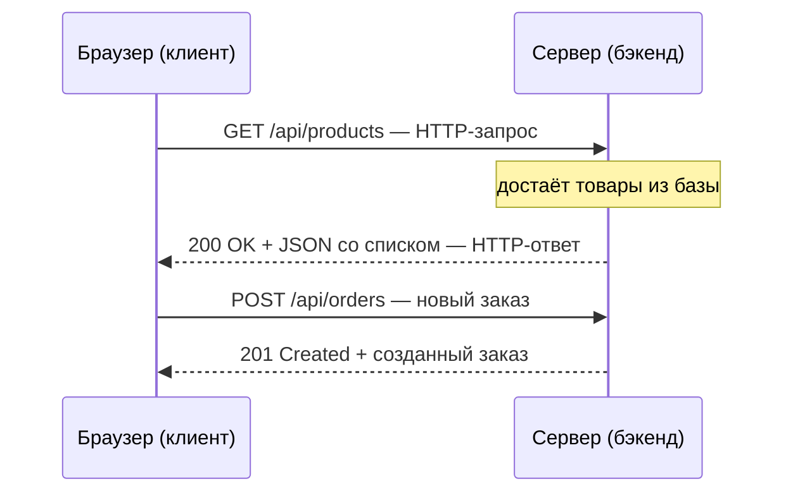

# Урок 1. Клиент–сервер и HTTP

Каждый раз, когда ты открываешь страницу интернет-магазина, ставишь лайк или жмёшь «Оформить заказ», между твоим браузером и чьим-то сервером происходит короткий строгий разговор. Он называется **HTTP** — и это язык, на котором фронтенд говорит с бэкендом.

Этот язык знает каждый участник продуктовой команды — но часто «на слух». К концу урока ты будешь понимать его структуру: из чего состоит запрос, что отвечает сервер и почему «404» — это не всегда баг.

## Клиент и сервер

Всё общение в вебе строится по модели **клиент–сервер**:

- **Клиент** — та программа, которая *просит*: браузер, мобильное приложение, Postman, скрипт.
- **Сервер** — программа, которая *отвечает*: принимает запрос, что-то делает (считает, ходит в базу) и возвращает ответ.

Сервер не «толкает» данные сам по себе (по крайней мере, в базовом HTTP): он сидит и ждёт запросов. Клиент всегда начинает разговор первым.



> **💡 Фронтендерам:** вы делаете это десятки раз в день — каждый `fetch()` / `axios.get()` в вашем коде и есть «клиент начинает разговор». Бэкенд — та сторона, которая отвечает.

> **🔧 QA-инженерам:** в Postman или DevTools → Network вы видите эти разговоры вживую. Этот урок — про структуру того, что вы там видите.

> **📐 Аналитикам:** представьте письмо: адрес получателя — это URL, конверт с пометками — заголовки, а сам текст письма — тело. HTTP устроен так же.

## Из чего состоит HTTP-запрос

Вот настоящий запрос, который браузер отправляет, когда вы открываете список товаров:

```http
GET /api/products?category=shoes HTTP/1.1
Host: shop.example.com
Accept: application/json
User-Agent: Mozilla/5.0
Authorization: Bearer eyJhbGciOi...
```

Разберём построчно:

| Часть | Пример | Что это |
|---|---|---|
| **Метод** | `GET` | Что сделать с ресурсом: прочитать, создать, изменить, удалить |
| **Путь (URL)** | `/api/products?category=shoes` | К какому ресурсу обращаемся. После `?` идут параметры-фильтры |
| **Версия** | `HTTP/1.1` | Диалект языка, сейчас почти везде 1.1 или 2 |
| **Заголовки** | `Host`, `Accept`, `Authorization` | Метаданные: куда, в каком формате ответ ждать, кто мы |
| **Тело** | *(у GET его нет)* | Данные, которые клиент передаёт серверу — у `POST` и `PUT` здесь JSON |

Всё вместе — метод + путь + заголовки + тело — это и есть запрос. Сервер смотрит на метод и путь, понимает, *что от него хотят*, и решает, какую логику запустить.

## Методы: GET, POST, PUT, PATCH, DELETE

Метод — это «глагол» запроса. Пять основных:

| Метод | Семантика | Тело запроса | Типичный пример |
|---|---|---|---|
| `GET` | Получить данные, ничего не менять | нет | «дай список товаров» |
| `POST` | Создать что-то новое | да (JSON) | «создай заказ из корзины» |
| `PUT` | Обновить объект целиком | да (JSON) | «замени профиль пользователя» |
| `PATCH` | Обновить часть полей | да (JSON) | «поменяй только email» |
| `DELETE` | Удалить | обычно нет | «удали товар из корзины» |

Важная привычка бэкенда: один и тот же путь с разными методами делает разное. `GET /api/orders` — «покажи заказы», `POST /api/orders` — «создай заказ». Метод — часть смысла, а не техническая деталь.

## Ответ: статус-код + заголовки + тело

Сервер всегда отвечает **статус-кодом** — трёхзначным числом, которое сразу говорит, как всё прошло:

| Класс | Значение | Частые примеры |
|---|---|---|
| `2xx` | Успех | `200 OK`, `201 Created`, `204 No Content` |
| `3xx` | Редирект | `301 Moved Permanently` |
| `4xx` | **Ошибся клиент** | `400 Bad Request`, `401 Unauthorized`, `403 Forbidden`, `404 Not Found` |
| `5xx` | **Ошибся сервер** | `500 Internal Server Error` |

Полезная шпаргалка для переписки в чатах:

- `401` — «я не знаю, кто ты» (не авторизован)
- `403` — «я знаю, кто ты, но нельзя» (нет прав)
- `404` — «такого ресурса нет»
- `500` — «всё сломалось на нашей стороне» (бэкендеру — в логи!)

Ответ на успешный `POST` (создание заказа) выглядит так:

```http
HTTP/1.1 201 Created
Content-Type: application/json
Location: /api/orders/42

{
  "id": 42,
  "status": "NEW",
  "items": [
    { "sku": "SHOE-01", "title": "Кроссовки", "price": 5990 }
  ]
}
```

`201`, а не `200` — маленький, но важный штрих: сервер не просто «ок», он сообщает, что ресурс *создан*, и в заголовке `Location` говорит, где его искать.

## JSON — язык обмена данными

Тело запроса и ответа почти всегда — **JSON**: текстовый формат «ключ – значение», читаемый и человеком, и программой.

```json
{
  "id": 42,
  "title": "Кроссовки",
  "price": 5990,
  "inStock": true,
  "tags": ["sports", "new"]
}
```

Правила простые: объект в `{}`, список в `[]`, строки в `""`, числа и `true`/`false`/`null` как есть. В Java (и в Spring Boot) этому формату соответствуют обычные классы с полями — но об этом в уроке 4.

> **💡 Фронтендерам:** JSON вы знаете идеально. Новое для вас — что на бэкенде этот JSON превращается в **Java-объект** автоматически: за это отвечает Spring Boot и специальные классы-DTO.

## Итог

- Веб = **клиент–сервер**: клиент всегда начинает разговор, сервер отвечает
- Запрос = **метод + путь + заголовки + тело**; метод — это смысл («прочитай» / «создай» / «удали»)
- Ответ = **статус-код + заголовки + тело**; `2xx` — успех, `4xx` — вина клиента, `5xx` — вина сервера
- **JSON** — формат обмена; на бэкенде он маппится в Java-объекты

Следующий урок — что происходит *на стороне сервера* после того, как он получил запрос: слои, база данных и почему бэкенд — это не «одна большая программа».

## Квиз

```quiz
- type: single
  question: "Ты открываешь в браузере адрес https://shop.example.com/products. Что делает браузер?"
  options:
    - "Отправляет HTTP-запрос GET на сервер shop.example.com"
    - "Скачивает себе всю базу товаров магазина"
    - "Устанавливает постоянное соединение и ждёт изменений"
    - "Ничего: сервер сам присылает страницу, когда появляются новости"
  correct: 0
  explanation: "Браузер — это клиент: он отправляет GET-запрос по пути /products и ждёт ответа. Инициатор разговора в HTTP — всегда клиент."

- type: single
  codeLang: http
  code: |
    HTTP/1.1 201 Created
    Content-Type: application/json
    Location: /api/orders/42

    {"id": 42, "status": "NEW"}
  question: "Посмотри на ответ сервера. Что означает статус 201?"
  options:
    - "Ресурс успешно создан, в Location — где его искать"
    - "Ошибка авторизации: нужно перелогиниться"
    - "Ресурс не найден, проверь URL"
    - "Всё в порядке, это просто разновидность OK без деталей"
  correct: 0
  explanation: "201 Created — успех создания ресурса. Заголовок Location показывает адрес нового объекта. «Просто OK» — это 200, он не сообщает о создании."

- type: multi
  question: "Какие утверждения про HTTP-методы верны? (несколько ответов)"
  options:
    - "GET используют, чтобы получить данные, не меняя их на сервере"
    - "POST отправляет данные на сервер — например, чтобы создать объект"
    - "DELETE обязан передавать JSON-тело с описанием того, что удаляем"
    - "PUT и POST различаются скоростью: PUT всегда быстрее"
  correct: [0, 1]
  explanation: "GET — чтение, POST — создание/отправка данных. Тело у DELETE обычно пустое (что удалять — сказано в пути), а различие PUT/POST — в смысле (полная замена vs создание), а не в скорости."

- type: blank
  question: "Какое значение должен иметь заголовок Content-Type, чтобы сообщить серверу, что тело запроса — JSON? Ответ в формате «тип/подтип»."
  answers:
    - "application/json"
  explanation: "Content-Type: application/json — стандартный способ сказать «тело — это JSON». Без него Spring Boot не поймёт, как разбирать тело запроса."

- type: match
  question: "Сопоставь HTTP-метод и его типичное назначение."
  pairs:
    - left: "GET"
      right: "Получить данные, не меняя их"
    - left: "POST"
      right: "Создать новый объект"
    - left: "PUT"
      right: "Обновить объект целиком"
    - left: "DELETE"
      right: "Удалить объект"

- type: single
  codeLang: http
  code: |
    GET /api/users/1042 HTTP/1.1
    Host: shop.example.com
    Authorization: Bearer eyJhbGciOi...
  question: "Запрос вернул статус 404, хотя пользователь 1042 точно существует в базе. Какая гипотеза хуже всего?"
  options:
    - "Бэкенд ищет пользователя не в той таблице — баг на сервере"
    - "В пути опечатка: например, /api/users/1O42 с буквой O вместо нуля"
    - "Токен в Authorization истёк — сервер не узнал клиента"
    - "Маршрут /api/users/{id} вообще не настроен в приложении"
  correct: 2
  explanation: "Истёкший или невалидный токен — это ошибка авторизации: сервер отвечает 401 (или 403), но не 404. А вот опечатка в id, отсутствие маршрута или баг с таблицей как раз дают именно «не найдено»."

- type: multi
  question: "Какие статус-коды говорят об ошибке на стороне клиента (класс 4xx)?"
  options:
    - "404 Not Found"
    - "401 Unauthorized"
    - "500 Internal Server Error"
    - "204 No Content"
  correct: [0, 1]
  explanation: "404 и 401 — класс 4xx, вина клиента (неверный ресурс / нет авторизации). 500 — серверная ошибка (5xx). 204 — вообще не ошибка: успешный ответ без тела."
```
