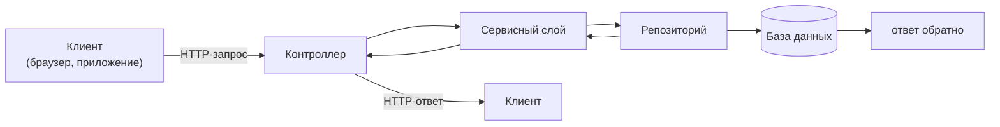

# Урок 2. Что такое бэкенд-сервис

В уроке 1 запрос долетел до сервера и получил ответ. Но что происходит «за дверью»? Из чего состоит программа, которая отвечает, и почему бэкенд — это почти всегда несколько слоёв, а не один большой файл?

## Сервис — это программа, которая слушает порт

Когда говорят «наш бэкенд», чаще всего имеют в виду **сервис** — отдельную программу (у нас это JVM-процесс на Java), которая:

1. запустилась на сервере,
2. открыла **порт** — «окно», через которое принимает HTTP-запросы,
3. работает в цикле: получила запрос → обработала → ответила → ждёт следующий.

В Spring Boot веб-сервер (Tomcat) встроен прямо в приложение: запустил jar-файл — сервис уже слушает HTTP. Не нужно ничего устанавливать и настраивать отдельно.

Порт — как квартира в многоквартирном доме: сервер имеет один адрес (например, `shop.example.com`), но в «квартире 8080» живёт бэкенд магазина, в «квартире 9090» — сервис уведомлений. Полный адрес сервиса складывается из хоста и порта: `http://shop.example.com:8080/api/...`

Если порт в настройках не указан, Spring Boot по умолчанию слушает **8080**.

## Что происходит с запросом внутри: слои

Запрос, попав в сервис, проходит через слои. У каждого — одна ответственность:



| Слой | Что делает | Не делает |
|---|---|---|
| **Контроллер** | Принимает HTTP, проверяет входные данные, вызывает сервис, формирует ответ | Не содержит бизнес-правил, не ходит в базу |
| **Сервисный слой** | Бизнес-логика: правила, вычисления, «что можно и нельзя» | Не знает про HTTP: ни URL, ни статус-коды |
| **Репозиторий** | Читает и записывает данные | Не решает бизнес-задачи |
| **База данных** | Долговременно хранит данные | Не считает скидки и не валидирует запросы |

**Зачем так сложно?** Три выгоды:

- **Локализация багов.** Пришёл `400` и «поле обязательно» — смотри контроллер. Заказ посчитан неверно — сервисный слой. Данные не сохранились — репозиторий или база.
- **Тестируемость.** Сервисный слой можно проверить без HTTP и базы — быстрые и стабильные тесты.
- **Изменяемость.** Поменять способ хранения (например, перейти на другую базу) можно, не трогая бизнес-логику.

> **💡 Фронтендерам:** вы уже пишите слоями: страница → хук/стор → API-клиент. Контроллер ≈ обработчик маршрута, сервисный слой ≈ бизнес-хук с правилами, репозиторий ≈ слой работы с API. Разница одна: у бэкенда под репозиторием настоящая база данных, а не чужой API.

> **🔧 QA-инженерам:** слои — ваш инструмент диагностики. Симптом + статус-код почти всегда подсказывают, где искать: `400`/`422` — валидация в контроллере, `500` с логом SQL — репозиторий, «логика посчитала не то» при `200 OK` — сервисный слой. Это сужает поле поиска бага в разы.

> **📐 Аналитикам:** слои = распределение ответственности. Требование «скидка не больше 50%» — это про сервисный слой, «у заказа обязательное поле email» — про контроллер, «история заказов хранится 5 лет» — про хранение. Когда вы знаете, про какой слой требование, его проще декомпозировать и проверить.

## Конфигурация: application.yml

Сервису нужно знать: какой порт слушать, как называется база, где брать секреты. Всё это живёт не в коде, а в **конфигурации** — файле `application.yml`:

```yaml
server:
  port: 8080

spring:
  application:
    name: orders-service
  datasource:
    url: jdbc:h2:mem:orders
    username: sa
```

Ключевые привычки:

- **Профили**: `application-dev.yml` для локальной разработки, `application-prod.yml` для боевого окружения. Код один — настройки разные.
- **Секреты** (пароли, токены) — не в файле и не в git, а в переменных окружения.
- Конфиг меняется без перекомпиляции: поменял порт — перезапустил.

## Почему не одна большая программа

Реальный бэкенд — это часто **несколько сервисов**: заказы, платежи, уведомления. Причины:

- разные команды развивают свои части независимо,
- сбой в уведомлениях не роняет оформление заказа,
- каждый сервис масштабируется под свою нагрузку.

Общаются сервисы двумя основными способами: **напрямую по HTTP** («заказ-сервис спросил у платежного статус») и **через брокер сообщений вроде Kafka** («заказ-сервис опубликовал событие "заказ создан" — все, кому важно, получили»). Как это устроено — в уроке 5.

## Итог

- Сервис = процесс со встроенным веб-сервером, который слушает порт (по умолчанию 8080) и отвечает на HTTP
- Внутри слои: **контроллер → сервис → репозиторий → база**; каждый слой отвечает за одно
- Конфигурация — в `application.yml`: порты, имя, база; профили dev/prod, секреты — в переменных окружения
- Система — это несколько сервисов, общающихся по HTTP и через Kafka

Дальше — короткая Java-шпаргалка, чтобы вы могли читать код этих слоёв. А после неё — первая практика.

## Квиз

```quiz
- type: single
  question: "Коллега говорит: «Наш бэкенд слушает порт 8080». Что это значит?"
  options:
    - "Сервис принимает HTTP-запросы, которые приходят на порт 8080 этого сервера"
    - "Приложение занимает 8080 мегабайт памяти"
    - "У приложения есть пул на 8080 потоков"
    - "Сервер выдерживает максимум 8080 запросов в секунду"
  correct: 0
  explanation: "Порт — это «окно» с номером, через которое процесс принимает входящие соединения. Адрес сервиса = хост + порт: http://host:8080."

- type: single
  codeLang: yaml
  code: |
    server:
      port: 9090

    spring:
      application:
        name: orders-service
  question: "Приложение с таким конфигом запущено на твоей машине. По какому адресу оно доступно?"
  options:
    - "http://localhost:9090"
    - "http://localhost:8080"
    - "http://orders-service:9090"
    - "http://localhost/9090"
  correct: 0
  explanation: "server.port: 9090 переопределяет дефолтный 8080. localhost = твоя машина, значит http://localhost:9090. Имя приложения — это метка для логов и метрик, не адрес."

- type: match
  question: "Сопоставь слой и его ответственность."
  pairs:
    - left: "Контроллер"
      right: "Принять HTTP-запрос и вернуть ответ"
    - left: "Сервисный слой"
      right: "Бизнес-правила и вычисления"
    - left: "Репозиторий"
      right: "Чтение и запись данных"
    - left: "База данных"
      right: "Долговременное хранение"

- type: multi
  question: "Какие утверждения про слои верны? (несколько ответов)"
  options:
    - "Контроллер не должен ходить в базу данных напрямую"
    - "Бизнес-правила вроде «скидка не больше 50%» живут в сервисном слое"
    - "Репозиторий знает, что такое HTTP-заголовки"
    - "Слои нужны в том числе для локализации багов"
  correct: [0, 1, 3]
  explanation: "Репозиторий — единственный слой, которому можно ничего не знать про HTTP: он про данные, а не про транспортировку запросов. Остальное — прямые следствия принципа «один слой — одна ответственность»."

- type: blank
  question: "Какой порт слушает Spring Boot-приложение по умолчанию, если в application.yml порт не задан?"
  answers:
    - "8080"
  explanation: "Дефолт Tomcat в Spring Boot — 8080. Занят? Меняй server.port в конфиге."

- type: single
  question: "Зачем в проекте конфиги application-dev.yml и application-prod.yml?"
  options:
    - "Код один, но настройки разные: локально — тестовая база и дебаг, в проде — боевая база и строгости"
    - "Чтобы в dev-профиле не писать бизнес-логику"
    - "Профили переключают язык ответов API"
    - "Это версии приложения: dev — старая, prod — новая"
  correct: 0
  explanation: "Профиль — набор настроек для окружения. Код и сборка одни и те же, меняется только окружение: базы, уровни логирования, внешние адреса."

- type: single
  question: "Пользователь оформил заказ на 3 позиции, в базу сохранился только 1. API ответил 200 OK, в ответе все 3 позиции. Какой слой — первый подозреваемый?"
  options:
    - "Сервисный слой: бизнес-логика передала на сохранение не всё"
    - "Контроллер: неверно разобрал запрос — но тогда ответ был бы 400 и без позиций"
    - "База данных: диск переполнен — но тогда был бы 500 и ошибка в логах"
    - "Веб-сервер: исчерпал потоки — но тогда запросы просто не доходили бы"
  correct: 0
  explanation: "Ответ 200 и корректный JSON говорят: контроллер отработал. База не падала (иначе 500). Значит, данные потерялись между сервисом и сохранением — ищем в сервисном слое. Это и есть диагностика по слоям."
```
