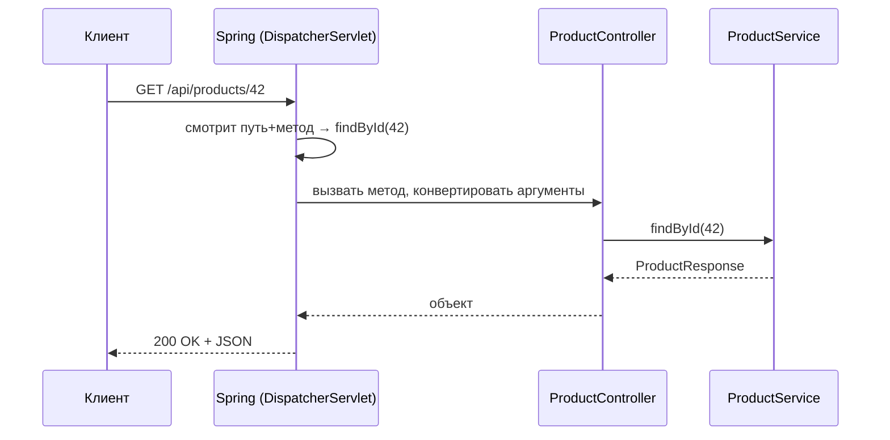

# Урок 4. Первый REST-контроллер

Собираем всё, что уже знаем: HTTP из урока 1, слои из урока 2, Java-шпаргалку из урока 3. Результат — настоящий Spring Boot-контроллер, который вы сможете не только прочитать, но и написать (в лабе 1).

## Аннотации, которые делают всё

В Spring контроллер — это обычный класс с аннотациями. Фреймворк видит их при старте, регистрирует маршруты и сам раздаёт входящие запросы:

```java
@RestController                          // этот класс принимает HTTP и возвращает JSON
@RequestMapping("/api/products")         // общий префикс путей
public class ProductController {

    private final ProductService productService;   // логика — в сервисном слое

    public ProductController(ProductService productService) {
        this.productService = productService;      // Spring сам подставит реализацию (DI)
    }

    @GetMapping                          // GET /api/products
    public List<ProductResponse> findAll() {
        return productService.findAll();
    }

    @GetMapping("/{id}")                 // GET /api/products/42
    public ProductResponse findById(@PathVariable Long id) {
        return productService.findById(id);
    }

    @PostMapping                        // POST /api/products
    @ResponseStatus(HttpStatus.CREATED)  // вернём 201, а не 200
    public ProductResponse create(@RequestBody CreateProductRequest request) {
        return productService.create(request);
    }
}
```

Как запрос находит метод:



Разбор аннотаций-переводчиков:

| Аннотация | Что делает |
|---|---|
| `@RestController` | «этот класс — REST-endpoint»: методы возвращают объекты, Spring сериализует их в JSON |
| `@GetMapping` / `@PostMapping` / `@PutMapping` / `@DeleteMapping` | какой HTTP-метод и путь обрабатывает метод |
| `@PathVariable` | кусочек пути (`42` из `/api/products/42`) → аргумент метода |
| `@RequestBody` | тело запроса (JSON) → Java-объект |
| `@ResponseStatus` | какой статус вернуть при успехе |

> **💡 Фронтендерам:** `@GetMapping("/api/products")` ≈ маршрут вашего роутера, `@RequestBody` ≈ `JSON.parse` + zod-схема: Spring сам распарсит тело и сложит его в объект. Вы пишете обработчик — фреймворк вызывает.

## DTO: контракт обмена, а не внутренности

Класс для ответа API — отдельный. Это **DTO** (Data Transfer Object):

```java
public record ProductResponse(          // record: неизменяемый класс данных
        Long id,
        String title,
        BigDecimal price
) {}
```

Зачем не отдавать «настоящий» объект из базы напрямую?

- **Стабильный контракт**: поменяли поле в хранилище — API не дрогнул; фронтенд не падает от лишних внутренних полей.
- **Безопасность**: не утечет `passwordHash` или себестоимость.
- **Понятно, чтоAPI**: DTO — это и есть описание API: поля запроса и ответа.

Для запросов — то же самое: `CreateProductRequest(String title, BigDecimal price)`. Spring превратит `{"title": "Кроссовки", "price": 5990}` в этот объект, а на ошибку валидации вернёт `400`.

## MapStruct: переливание полей без боли

Внутри приложения — свои объекты (entity, о них в уроке 5), снаружи — DTO. Между ними нужен «переливальщик». **MapStruct** генерирует его сам:

```java
@Mapper(componentModel = "spring")      // реализацию соберёт Spring
public interface ProductMapper {
    ProductResponse toResponse(Product product);      // entity → DTO
    Product toEntity(CreateProductRequest request);   // DTO → entity
}
```

Одна строчка на преобразование — MapStruct сгенерирует класс с честным `new ProductResponse(product.getId(), product.getTitle(), ...)`. Скучные присваивания полей больше не пишут руками.

> **🔧 QA-инженерам:** MapStruct-мапперы — любимое место коварных багов: поле забыли замапить — в ответе будет `null`. Проверяйте не только статус 200, но и значения всех полей DTO.

## Код-first и API-First: два подхода к дизайну API

Мы писали код — и API получался каким вышел (это **code-first**). Есть и обратный путь — **API-First**:

1. Сначала **контракт**: OpenAPI-файл (YAML), где описаны пути, запросы, ответы, коды ошибок.
2. Из контракта **генерируется** код: заготовки контроллеров на бэкенде и типизированные клиенты на фронтенд.
3. Контракт — предмет договора: фронтендер, QA и аналитик читают его до того, как код написан.

API-First особенно силён, когда API много и их потребляют другие команды. Погружение в контрактный подход и сравнение с GraphQL (альтернативный стиль API, где клиент сам просит нужные поля) — тема отдельного модуля «Проектирование API».

## Итог

- Контроллер = класс с `@RestController`; аннотации маппинга связывают метод+путь с HTTP
- `@PathVariable` — из пути, `@RequestBody` — из тела; Spring сам конвертирует JSON ↔ объекты
- API принимает и возвращает **DTO** — стабильный контракт, а не внутренние объекты
- **MapStruct** генерирует перевод entity ↔ DTO
- Есть два мира: code-first (пишем код — API получается) и **API-First** (сначала контракт OpenAPI, потом генерация)

Осталось собрать последний слой пазла: что происходит в сервисе и репозитории, причём тут Hibernate и Kafka — урок 5. А пока — первая настоящая кодовая практика.

## Квиз

```quiz
- type: single
  codeLang: java
  code: |
    @RestController
    @RequestMapping("/api/orders")
    public class OrderController {

        @GetMapping("/{id}")
        public OrderResponse findById(@PathVariable Long id) { ... }
    }
  question: "Какой запрос обработает метод findById?"
  options:
    - "GET /api/orders/42"
    - "POST /api/orders/42"
    - "GET /api/orders?id=42"
    - "GET /findById/42"
  correct: 0
  explanation: "Префикс класса + путь метода: /api/orders + /{id}. {id} — переменная кусок пути, её значение попадает в аргумент через @PathVariable. Метод задан @GetMapping — значит HTTP GET."

- type: single
  question: "Метод контроллера помечен @RequestBody CreateProductRequest request. Что делает Spring с телом запроса?"
  options:
    - "Распарсит JSON тела и соберёт из него объект CreateProductRequest"
    - "Передаст тело как сырую строку"
    - "Проигнорирует тело — оно недоступно в Spring"
    - "Сохранит тело сразу в базу данных"
  correct: 0
  explanation: "@RequestBody = «тело запроса → объект»: Spring десериализует JSON в ваш класс. Если JSON не соответствует — клиент получит 400 Bad Request."

- type: multi
  question: "Зачем API принимает и возвращает DTO, а не внутренние объекты приложения? (несколько ответов)"
  options:
    - "API-контракт стабилен: внутренние refactor'ы не ломают клиентов"
    - "Не утекут внутренние и секретные поля (себестоимость, passwordHash)"
    - "DTO ускоряют запросы к базе данных"
    - "DTO обязательны по стандарту языка Java"
  correct: [0, 1]
  explanation: "DTO — про контракт и безопасность. Скорость базы они сами по себе не добавляют, и это не требование языка — это архитектурная привычка."

- type: match
  question: "Сопоставь аннотацию и её роль."
  pairs:
    - left: "@RestController"
      right: "Класс принимает HTTP и возвращает JSON"
    - left: "@RequestBody"
      right: "Тело запроса → Java-объект"
    - left: "@PathVariable"
      right: "Кусочек пути → аргумент метода"
    - left: "@ResponseStatus"
      right: "Статус-код успешного ответа"

- type: blank
  question: "Какая аннотация Spring превращает обычный класс в REST-контроллер? Напиши её с собакой."
  answers:
    - "@RestController"
  explanation: "@RestController = @Controller + @ResponseBody: методы возвращают объекты, которые Spring сериализует в JSON."

- type: single
  codeLang: java
  code: |
    @Mapper(componentModel = "spring")
    public interface ProductMapper {
        ProductResponse toResponse(Product product);
    }
  question: "Что делает MapStruct с этим интерфейсом?"
  options:
    - "Генерирует реализацию, которая перекладывает поля Product в поля ProductResponse"
    - "Ничего: интерфейс без реализации нерабочий, код упадёт при старте"
    - "Превращает ProductResponse в JSON в базе данных"
    - "Создаёт REST-endpoint /api/mapper"
  correct: 0
  explanation: "MapStruct на этапе компиляции генерирует класс-реализацию с присваиванием одноимённых полей. Руками эти присваивания писать не нужно; отличия имён настраиваются аннотациями @Mapping."

- type: single
  question: "Команда работает по API-First. Продакт просит новое поле в ответе заказа. С чего правильно начать?"
  options:
    - "С правки контракта OpenAPI и согласования с потребителями API, потом генерация и код"
    - "С добавления поля в Java-класс ответа — контракт догонит потом"
    - "С изменения базы данных, остальное приложится"
    - "С письма фронтендерам: «поле уже есть, проверьте»"
  correct: 0
  explanation: "API-First = контракт сначала: OpenAPI — источник правды. Сначала правим и согласуем специкацию с теми, кто API потребляет, затем генерируем/пишем код под неё. Добавить поле «сразу в класс» — путь code-first, он ломает саму идею договора."
```
