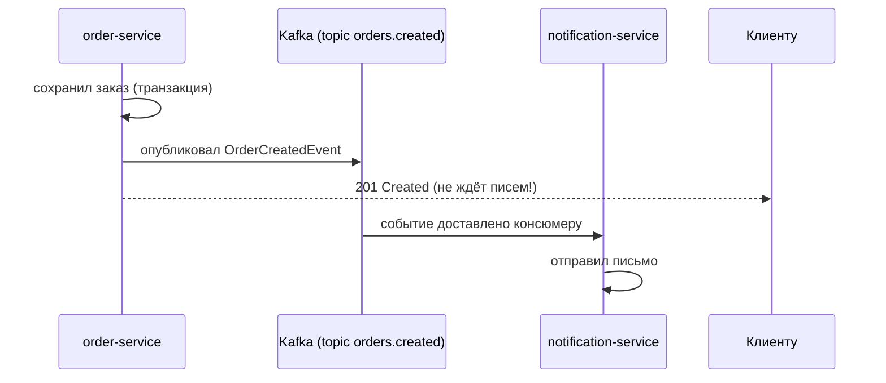

# Урок 5. Слои приложения и Kafka

Последний пазл пилота: как слои работают вместе, что именно делает Hibernate в репозитории, куда в этой картине встаивает Kafka — и как понять, что живой сервис жив.

## Сервисный слой: бизнес-сердце

Всё «что можно и почём» — здесь:

```java
@Service
public class OrderService {

    private final OrderRepository orderRepository;
    private final OrderMapper orderMapper;

    public OrderService(OrderRepository orderRepository, OrderMapper orderMapper) {
        this.orderRepository = orderRepository;
        this.orderMapper = orderMapper;
    }

    @Transactional                       // метод = транзакция: всё или ничего
    public OrderResponse create(CreateOrderRequest request) {
        if (request.items().isEmpty())                       // бизнес-правило
            throw new EmptyOrderException();

        Order order = orderMapper.toEntity(request);
        order.setStatus("NEW");
        Order saved = orderRepository.save(order);           // в базу
        return orderMapper.toResponse(saved);
    }
}
```

`@Transactional` — «всё или ничего»: если после сохранения заказа что-то упадёт, база останется как была. Половинчатых заказов не бывает.

## Репозиторий и Hibernate: база без SQL

Самая большая магия Spring Data. Репозиторий — просто интерфейс:

```java
public interface OrderRepository extends JpaRepository<Order, Long> {
    List<Order> findByCustomerIdAndStatus(Long customerId, String status);
}
```

`JpaRepository` дарит готовые `save`, `findById`, `deleteById` и умеет **сам генерировать SQL по имени метода**: `findByCustomerIdAndStatus` превратится в `WHERE customer_id = ? AND status = ?`. SQL вы увидите в логах, но писать руками — почти никогда.

А `Order` — это **entity**: Java-класс, отображённый на таблицу:

```java
@Entity
@Table(name = "orders")
@Getter @Builder
public class Order {
    @Id @GeneratedValue(strategy = GenerationType.IDENTITY)
    private Long id;
    private Long customerId;
    private String status;
    private BigDecimal amount;
}
```

Это и есть **Hibernate/JPA**: аннотациями мы говорим «класс = таблица, поле = колонка», а фреймворк переводит объекты в SQL-запросы и обратно. В лабах база — H2, in-memory: поднялась с приложением, умерла с ним. Боевая СУБД (PostgreSQL) — тот же код, другой `datasource.url` в конфиге.

Схема таблиц меняется не «руками в базе», а **миграциями** (Liquibase): файл в репо = шаг изменения схемы, применяется автоматически при старте.

Вся картина вместе:

```mermaid
flowchart TD
    C["Клиент"] -->|"HTTP + JSON"| K["Контроллер<br/>(DTO, валидация)"]
    K --> S["Сервис<br/>(бизнес-логика, @Transactional)"]
    S --> M["MapStruct<br/>entity ↔ DTO"]
    S --> R["Репозиторий<br/>(JpaRepository)"]
    R --> DB[("База данных<br/>(H2 / PostgreSQL)"]
    S --> P["KafkaTemplate<br/>(публикация событий)"]
    P --> T["Kafka: topic orders.created"]
    T --> N["Другие сервисы:<br/>уведомления, аналитика"]
```

## Куда встаивает Kafka

HTTP хорош, когда caller'у нужен ответ *сейчас*. Но часть работы — фоновая: отправить письмо, посчитать аналитику, синхронизовать поиск. Держать запрос пользователя пока отправляется письмо — расточительно.

Паттерн: сервис сделал свою работу → опубликовал **событие** в Kafka → пошёл дальше. Кто хотел — прочитал и отработал:

```java
kafkaTemplate.send("orders.created", new OrderCreatedEvent(order.getId()));
```



Ключевые слова: **продюсер** публикует, **консюмер** подписан, **topic** — именованный канал событий. События в Kafka сохраняются и могут быть перечитаны — этим она отличается от «просто почтового ящика». Вглубь — в отдельном модуле.

## Наблюдаемость: Actuator и Micrometer

Сервис в проде — как самолёт: нужно, чтобы он сам сообщал о своём состоянии. В Spring Boot за это отвечают два инструмента.

**Actuator** — встроенные эксплуатационные endpoints:

| Endpoint | Что показывает |
|---|---|
| `/actuator/health` | Жив ли сервис: `{"status": "UP"}`; включает проверки базы, Kafka и др. |
| `/actuator/metrics` | Числовые метрики: память, время ответов, счётчики |
| `/actuator/info` | Информация о сборке |

`/actuator/health` — рабочая лошадка деплоя: балансировщик и Kubernetes-пробы опрашивают его и решают, направлять ли трафик на инстанс или перезапустить его.

**Micrometer** — «фасад метрик»: единый API для счётчиков и таймеров, который экспортирует данные в системы мониторинга (Prometheus и другие). Один раз написали метрику — увидели её на дашборде команды:

```java
Counter created = meterRegistry.counter("orders.created.total");
created.increment();     // +1 заказ — график на дашборде пополз вверх
```

> **🔧 QA-инженерам:** `/actuator/health` — ваш первый инструмент при «а сервис вообще жив?»: UP/DOWN и причина, без доступа к серверу. А метрики — готовые данные для проверки нечерного-box поведения.

> **📐 Аналитикам:** события Kafka (`orders.created`) и метрики (`orders.created.total`) — это то, из чего строятся продуктовые дашборды в реальном времени. Требование «видеть конверсию заказов онлайн» — это требование к событию и метрике.

## Итог

- Сервис держит бизнес-правила; `@Transactional` даёт «всё или ничего»
- Репозиторий — интерфейс: Spring Data генерирует SQL; entity = таблица, миграции — через Liquibase
- Kafka: опубликовал событие → пошёл дальше; фоновые потребители дочитают
- Actuator даёт `/actuator/health` и метрики; Micrometer — единый API для дашбордов

Пилот собран: вы прошли путь от HTTP-запроса до живого сервиса со слоями, базой, событиями и метриками. Дальше — экзамен и кейс, проверяющие весь модуль целиком.

## Квиз

```quiz
- type: single
  codeLang: java
  code: |
    public interface OrderRepository extends JpaRepository<Order, Long> {
        List<Order> findByCustomerIdAndStatus(Long customerId, String status);
    }
  question: "Что верно про этот репозиторий?"
  options:
    - "Spring Data сам сгенерирует реализацию и SQL по имени метода — писать нечего"
    - "Это нерабочий код: у интерфейса нет реализации"
    - "Метод нужно вручную реализовать в классе OrderRepositoryImpl"
    - "Метод сработает только если написать SQL в аннотации"
  correct: 0
  explanation: "JpaRepository даёт готовые save/findById/deleteById, а по имени findByCustomerIdAndStatus Spring Data выводит WHERE customer_id = ? AND status = ?. Реализация генерируется при старте приложения."

- type: single
  question: "Метод сервиса помечен @Transactional. Что это гарантирует?"
  options:
    - "Либо все записи в базу внутри метода применятся, либо ни одна"
    - "Метод выполнится быстрее — в отдельном потоке"
    - "Ответ метода всегда со статусом 200"
    - "Метод нельзя вызвать дважды одновременно"
  correct: 0
  explanation: "Транзакция = атомарность: ошибка на середине откатывает всё сделанное ранее в методе. Половина заказа не сохранится никогда. Про потоки и статусы аннотация ничего не обещает."

- type: match
  question: "Сопоставь понятие и его смысл."
  pairs:
    - left: "Entity"
      right: "Java-класс, отображённый на таблицу"
    - left: "Kafka topic"
      right: "Именованный канал событий"
    - left: "@Service"
      right: "Слой бизнес-правил"
    - left: "Liquibase"
      right: "Версионирование схемы базы миграциями"

- type: multi
  question: "Какие утверждения про Kafka в этой архитектуре верны? (несколько ответов)"
  options:
    - "Продюсер публикует событие в topic и не ждёт фоновой обработки"
    - "Консюмеры подписываются на topic и обрабатывают события сами"
    - "Kafka заменяет базу данных: заказы хранятся только в topic"
    - "Тяжёлую фоновую работу выносят в консюмеры, чтобы API отвечал быстро"
  correct: [0, 1, 3]
  explanation: "Kafka — транспорт и буфер событий, а не хранилище записей заказа: источником правды остаётся база. Остальное — суть паттерна: событие опубликовано, фоновые потребители отработали в своём темпе."

- type: blank
  question: "Какой endpoint Actuator'а возвращает статус живости сервиса (UP/DOWN)? Ответ начни с /actuator/"
  answers:
    - "/actuator/health"
  explanation: "GET /actuator/health — стандартная точка проверки: её опрашивают балансировщики и Kubernetes-пробы, чтобы решать, жив ли инстанс."

- type: single
  question: "Мониторинг показывает: /actuator/health отвечает {\"status\": \"DOWN\", \"components\": {\"db\": {\"status\": \"DOWN\"}}}. Что случилось?"
  options:
    - "Сервис работает, но не может подключиться к базе данных — трафик на него направлять нельзя"
    - "Упало всё приложение: процесс мёртв, health отвечает последний раз"
    - "Ничего страшного: DOWN бывает при обновлении схемы базы"
    - "Ошибка в коде контроллера: вернуть 500 клиенту"
  correct: 0
  explanation: "Health-проверка сама жива (она ответила!) и сообщает причину: база недоступна. Приложение поднимают заново, только если падает liveness-проба, а здесь задача — чинить подключение к БД."

- type: single
  question: "Зачем в проекте Micrometer, если метрики можно писать в логи?"
  options:
    - "Micrometer — единый API метрик (счётчики, таймеры) с экспортом в системы мониторинга и дашборды"
    - "Micrometer заменяет логирование: логи больше не нужны"
    - "Micrometer ускоряет работу базы данных"
    - "Это требование Spring Boot: без него приложение не стартует"
  correct: 0
  explanation: "Метрики — это числа с именами и тегами, которые должны попасть в Prometheus/графики, а не в текст логов. Micrometer даёт один API и разные экспорты; логи при этом остаются для другого — контекста происшествий."
```
