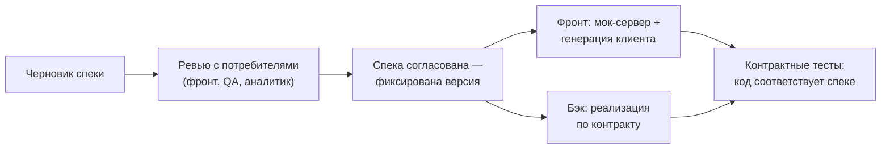

# Урок 1. API как договор

В модуле 1 мы писали код — и API «получался». Работает, пока потребителей мало. Как только ваш API кто-то использует — фронтенд, мобильное приложение, другой сервис — каждое изменение становится чужой проблемой. Этот модуль про то, как проектировать API осознанно: сначала договор, потом код.

## API — это интерфейс, а не «код, который случайно наружу»

**API** (Application Programming Interface) — граница, через которую одна программа говорит с другой. Для бэкенда это набор эндпоинтов: пути, методы, запросы, ответы, ошибки, форматы.

Ключевая мысль: **API — это договор между вами и потребителями**. Как только договор подписан (кто-то начал его использовать), одностороннее изменение условий — нарушение. Бэкендер может рефакторить внутренности сколько угодно; контракт — только по правилам.

Кто потребители вашего API на самом деле:

- **Фронтенд** — веб-приложение
- **Мобильные приложения** — их нельзя «обновить всех сразу»: у пользователей старые версии живут месяцами
- **Другие сервисы** — внутренние и внешние интеграции
- **QA-автотесты** — тоже потребитель: тесты завязаны на контракт
- **Аналитики** — если API отдаёт данные для дашбордов

## Цена сломанного контракта

Классика жанра:

1. Бэкенд переименовал поле `name` в `fullName` — «так правильнее»
2. Фронт собирался на старом контракте и уже уехал в прод
3. Везде, где было имя пользователя, — пустота
4. Почти у всех сторон «работало у меня локально»

Ошибка не в переименовании, а в том, что оно произошло **молча**. Договор меняют открыто: предупредить, версионировать, дать время на переезд.

## Два подхода: code-first и API-First

| | Code-first | API-First |
|---|---|---|
| Что сначала | Код контроллера | Контракт (OpenAPI-спека) |
| Документация | Побочный продукт (генерится из кода, если повезёт) | Первична и всегда актуальна |
| Ревью | Ревью кода — контракт уже «случился» | Ревью контракта — до написания кода |
| Потребители узнают о API | Когда задеплоено | По спеке — ещё до реализации |
| Скорость старта | Быстро на старте | Чуть медленнее на старте |
| Цена изменения потом | Дорого (кто-то уже завязался) | Дёшево на этапе договора |

Code-first не «неправильный» — для маленького внутреннего сервиса или прототипа он разумен. API-First выигрывает, когда потребителей больше одного (или они появятся), когда фронт и бэк работают параллельно, когда API живёт годами.

## OpenAPI: договор, который исполняется

**OpenAPI** — стандарт описания REST API: YAML- или JSON-файл, в котором формально записаны все пути, параметры, схемы запросов/ответов и ошибки. Та же идея, что TypeScript-типы, только для HTTP-границы между командами.

Из этого файла вырастает вся инфраструктура договора:

- **Swagger UI** — интерактивная документация: читаем и пробуем запросы прямо из браузера
- **Генерация кода** — типизированные клиенты для фронта (TS) и заготовки интерфейсов для бэкенда (Java)
- **Мок-сервер** — фронтенд работает с «фейковым» API по спеке, пока бэкенд реализует
- **Контрактные тесты** — проверка, что живой API не разошёлся с договором

Формат спеки — тема урока 2. Пока важно: договор существует в машиночитаемом виде, а не «в голове у бэкендера и в устаревшей Confluence-странице».

## Как выглядит цикл API-First



Заметьте: фронтенд не ждёт бэкенд. Обе стороны работают параллельно против одного договора — это главный выигрыш API-First по срокам.

> **💡 Фронтендерам:** вы уже живёте в контрактном мире: TS-интерфейсы между модулями, типы из бэкенда. OpenAPI — тот же интерфейс, только на границе HTTP, и из него генерится ваш API-клиент с типами. Больше не нужен слой ручных обёрток над fetch.

> **🔧 QA-инженерам:** спека — готовая основа тест-анализа: каждый путь и код ответа из неё — кейс в матрице. Примеры из спеки (examples) — готовые тест-данные. А контрактные тесты в CI — это ваш «регресс контракта» бесплатно.

> **📐 Аналитикам:** вы — соавтор договора. Поля, их семантика, коды ошибок, сценарии — всё это фиксируется в спеке до кода. Ваше «а добавьте поле» в мире API-First — это правка контракта с ревью, а не просьба «по-тихому поправить в коде».

## Итог

- API — договор; после появления потребителей менять его можно только открыто и по правилам
- Потребителей больше, чем кажется: фронт, мобилки, сервисы, автотесты, аналитика
- Code-first — норм для прототипов; API-First — для API, которые живут и у которых есть потребители
- OpenAPI — машиночитаемый договор: документация, генерация клиентов, моки, контрактные тесты
- В API-First фронт и бэк работают параллельно против спеки

В следующем уроке откроем реальную OpenAPI-спеку и научимся её читать и писать.

## Квиз

```quiz
- type: single
  question: "Бэкенд переименовал поле name в fullName и задеплоил в пятницу вечером. Фронтенд узнал об этом в понедельник из падения продакшена. Что было нарушено?"
  options:
    - "Договор: изменение контракта прошло без предупреждения и без переходного периода"
    - "Ничего: внутренние поля бэкенда — его дело"
    - "Соглашение об именовании Java-полей"
    - "Процесс деплоя: нельзя деплоить по пятницам"
  correct: 0
  explanation: "Поле name было частью контракта — фронт на него завязался. Договор меняют открыто: предупредить потребителей, поддержать оба поля переходный период, объявить deprecation старого."

- type: multi
  question: "Кто является потребителями API интернет-магазина? (несколько ответов)"
  options:
    - "Веб-фронтенд"
    - "Мобильное приложение, которое пользователи обновляют с задержкой"
    - "QA-автотесты, завязанные на запросы и ответы"
    - "Разработчик, который написал контроллер"
  correct: [0, 1, 2]
  explanation: "Потребитель — тот, кто завязан на контракт снаружи. Автор контроллера — не потребитель: он может рефакторить внутренности, контракт меняется по другим правилам."

- type: single
  question: "В чём главное преимущество API-First по срокам разработки фичи?"
  options:
    - "Фронтенд и бэкенд работают параллельно: фронт — против мок-сервера по спеке, бэк — реализует контракт"
    - "Код пишется быстрее, потому что OpenAPI ускоряет Java"
    - "QA начинает тестирование до постановки задачи"
    - "Не нужно писать код контроллера вообще"
  correct: 0
  explanation: "Спека + мок-сервер развязывают команды по времени. Код писать всё равно нужно — генерация даёт заготовки и клиентов, а не реализацию."

- type: match
  question: "Сопоставь артефакт OpenAPI и то, что из него получается."
  pairs:
    - left: "Swagger UI"
      right: "Интерактивная документация с возможностью попробовать запросы"
    - left: "Генерация клиента"
      right: "Типизированный код для вызова API (например, на TypeScript)"
    - left: "Мок-сервер"
      right: "Фейковый API, отвечающий по спеке без реализации"
    - left: "Контрактные тесты"
      right: "Проверка, что живой API соответствует договору"

- type: blank
  question: "Как называется стандарт машиночитаемого описания REST API в YAML/JSON? (одно слово, имя собственное)"
  answers:
    - "OpenAPI"
  explanation: "OpenAPI Specification. Swagger — имя инструментария вокруг стандарта (UI, Codegen); сам формат называется OpenAPI."

- type: single
  question: "Какой проект разумно вести в code-first, а не в API-First?"
  options:
    - "Прототип внутреннего сервиса, у которого пока один потребитель — команда-автор"
    - "Публичное API для внешних партнёров"
    - "API, по которому фронт и мобильная команда работают параллельно с бэкендом"
    - "API, которое живёт третий год и у него пять интеграций"
  correct: 0
  explanation: "Чем больше потребителей и дольше жизнь API, тем дороже «случайный» контракт. Прототип для себя — законная зона code-first: договор ещё не подписан."

- type: single
  codeLang: yaml
  code: |
    # фрагмент OpenAPI-спеки
    paths:
      /api/tasks/{id}:
        get:
          responses:
            "200":
              description: Задача найдена
  question: "Что можно сказать об этом API, глядя на фрагмент спеки?"
  options:
    - "Описан GET-запрос /api/tasks/{id}, где id — параметр пути"
    - "Описано создание задачи POST-запросом"
    - "Это GraphQL-схема"
    - "Спека описывает базу данных: таблицу tasks"
  correct: 0
  explanation: "Раздел paths описывает эндпоинты: путь с параметром {id}, метод get, ожидаемый ответ 200. Спека — про контракт HTTP, а не про базу: как хранится — её не волнует."
```
