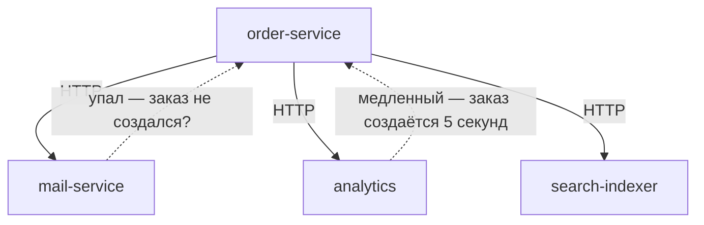
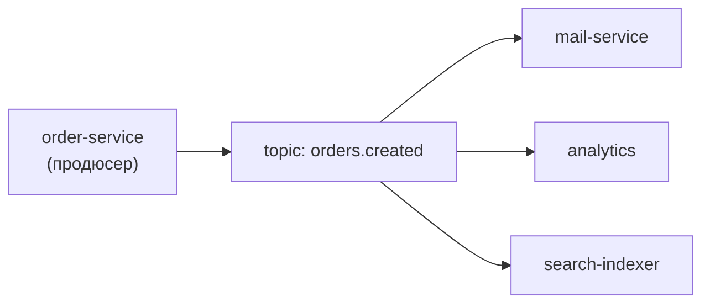

# Урок 1. Зачем брокер: асинхронный мир

В пилоте Kafka мелькнула одной картинкой: «сделал дело — опубликовал событие». Теперь — вглубь: как брокер устроен, кто такие партиции и офсеты, почему сообщения не теряются (и когда теряются), и какие паттерны делают асинхронность надёжной. Начнём с мотивации.

## Что не так с прямыми вызовами

Сервис заказов должен уведомить о новом заказе: письма, аналитику, поиск. Прямое решение — вызвать всех по HTTP из транзакции создания заказа:



Проблемы нарастают как снежный ком:

- **Связанность**: заказ знает про всех потребителей и их адреса; новый подписчик = правка заказa
- **Каскадные сбои**: почтовый лежит — заказы не оформляются
- **Задержка**: клиент ждёт самого медленного
- **Потеряные события**: сервис analytics перезапускают — что случилось в этот момент, никто не узнает

## Событие и брокер

Меняем модель: заказ-сервис **публикует факт** — «заказ создан» — в именованный канал (**topic**), не зная, кто читает. Потребители **подписаны** и читают в своём темпе. Между ними — **брокер** (Kafka): принимает, хранит, раздаёт.



Что это меняет по сравнению с прямым вызовом:

| | Прямые HTTP-вызовы | Через брокер |
|---|---|---|
| Кто кого знает | Заказ знает всех | Никто никого не знает, только topic |
| Потребитель лежит | Отравитель звонков страдает | События копятся, догонит после старта |
| Добавить потребителя | Правка кода заказa | Подписаться на topic — код не меняется |
| Темп | Синхронно, ждём всех | Каждый читает со своей скоростью |
| История | Нет (мимо = потеряно) | Kafka хранит события: можно перечитать |

Важно понимать смену смысла: HTTP-вызов — это **команда** («отправь письмо»), событие — это **факт** («заказ создан»). Событие уже случилось и не может «не отправиться» из-за чьего-то сбоя.

## Доставка: at-least-once и последствия

Сетей без потерь не бывает, поэтому Kafka по умолчанию гарантирует **at-least-once**: сообщение доставится **хотя бы один раз** — а значит, иногда **дважды** (ретрай после неуверенного таймаута).

Следствие — главное правило асинхронного мира:

> **Консюмер должен быть идемпотентным**: повторная обработка того же события не должна создавать дубль.

«Отправить письмо повторно» — терпимо. «Начислить бонус повторно» — нет: обработчик проверяет, не обработал ли он уже это событие (по id), прежде чем действовать. Это тема урока 5, но помните о ней с первой минуты.

## События в коде: как это выглядит

Публикация в Spring — одна строка (продюсер):

```java
@Service
@RequiredArgsConstructor
public class OrderService {

    private final KafkaTemplate<String, OrderCreatedEvent> kafkaTemplate;

    @Transactional
    public OrderResponse create(CreateOrderRequest request) {
        Order order = /* создать и сохранить */;
        kafkaTemplate.send("orders.created",
                String.valueOf(order.getId()),
                new OrderCreatedEvent(order.getId(), order.getAmount()));
        return toResponse(order);
    }
}
```

Чтение — листенер (консюмер), его напишет подписчик:

```java
@KafkaListener(topics = "orders.created", groupId = "mail-service")
public void onOrderCreated(OrderCreatedEvent event) {
    mailService.sendOrderConfirmation(event.orderId());
}
```

`groupId` — «кто я такой»: все инстансы mail-service в одной группе делят работу между собой. Как именно — урок 3.

> **💡 Фронтендерам:** pub/sub вы видели в шинах событий (EventBus, Redux). Kafka — то же, но события персистентны: подписчик может «перемыть» историю. `groupId` ≈ имя подписчика: один и тот же обработчик в нескольких вкладках не должен получать копию события.

> **🔧 QA:** асинхронность меняет тестирование: проверка «нажал кнопку — пришло письмо» больше не транзакция, а цепочка с задержкой. Тестируйте событие как отдельный контракт: опубликовали `orders.created` — слушатели обязаны отработать; и обязательно — повторную доставку (at-least-once!).

> **📐 Аналитикам:** событие — первичный факт предметной области: «заказ создан», «платёж прошёл». Продуктовая аналитика в реальном времени строится именно на потоке событий, а не на ночных выгрузках таблиц. Вы помогаете называть события так, чтобы они были понятны через год.

## Итог

- Прямые вызовы связывают сервисы и каскадируют сбои; брокер развязывает их по времени и знанию
- Событие — факт, уже случившийся; команда — просьба что-то сделать; Kafka про факты
- Kafka хранит события: потребители читают в своём темпе, могут перечитать
- Гарантия доставки — at-least-once: повторы возможны, консюмер обязан быть идемпотентным
- В Spring: `kafkaTemplate.send(topic, key, event)` и `@KafkaListener(topics, groupId)`

Дальше — внутрь брокера: топики, партиции и почему порядок сообщений связан с ключами.

## Квиз

```quiz
- type: single
  question: "Заказ-сервис синхронно вызывает почтовый, аналитику и индексатор поиска. Почтовый упал. Что происходит с оформлением заказов?"
  options:
    - "Зависит от обработки ошибок: либо заказ падает вместе с почтой, либо письмо теряется — обе стороны плохи"
    - "Ничего: вызовы независимы"
    - "Kafka доставит письмо позже"
    - "Заказ всегда создаётся, письма накапливаются в базе"
  correct: 0
  explanation: "Синхронная цепочка без запасного пути: либо транзакция падает (клиент страдает), либо событие теряется (молча). Брокер разрубает эту развилку: событие фиксируется и ждёт подписчика."

- type: single
  question: "Чем событие «orders.created» принципиально отличается от команды «sendOrderEmail»?"
  options:
    - "Событие — уже случившийся факт, издатель не знает и не ждёт обработчиков; команда — просьба что-то сделать конкретному исполнителю"
    - "Ничем: это синонимы"
    - "События пишутся только в базу"
    - "Команды нельзя отправлять в Kafka"
  correct: 0
  explanation: "Факт не может «не удаться» и не адресован никому. Из этого растёт вся развязка: новые подписчики без правок издателя, независимые темпы, перечитывание."

- type: multi
  question: "Что даёт переход на брокер? (несколько ответов)"
  options:
    - "Новый потребитель подписывается без правок издателя"
    - "Упавший потребитель догоняет пропущенное после перезапуска"
    - "Гарантия exactly-once из коробки без усилий"
    - "Издатель не ждёт самых медленных подписчиков"
  correct: [0, 1, 3]
  explanation: "Exactly-once из коробки не бывает: at-least-once + идемпотентность обработчика — вот реальный контракт."

- type: blank
  question: "Как называется гарантия доставки «хотя бы один раз, возможны повторы»? (формат: at-…-once)"
  answers:
    - "at-least-once"
    - "at least once"
  explanation: "At-least-once. Повторы — норма, поэтому консюмер проектируют идемпотентным."

- type: match
  question: "Сопоставьте понятие и роль."
  pairs:
    - left: "Topic"
      right: "Именованный канал событий"
    - left: "Продюсер"
      right: "Публикует события в topic"
    - left: "Консюмер"
      right: "Подписан и читает события"
    - left: "groupId"
      right: "Имя группы: её инстансы делят чтение между собой"

- type: single
  question: "Консюмер начисляет бонус за регистрацию, слушая user.registered. Событие пришло дважды (at-least-once). Что нужно в обработчике?"
  options:
    - "Идемпотентность: проверить по id события, не начислен ли уже бонус, и только тогда действовать"
    - "Ничего: повторы игнорируются брокером автоматически"
    - "Переключить Kafka на exactly-once"
    - "Отправить письмо дважды — так задумано"
  correct: 0
  explanation: "Повторы — свойство доставки, а не чья-то ошибка. Обработчик обязан быть безопасным к повтору: уникальный ключ, проверка «уже сделано», транзакция с идемпотентной записью."

- type: single
  question: "Продакт хочет новое событие «заказ доставлен» для пуш-уведомлений и обновления аналитики. Что меняется в сервисе заказов?"
  options:
    - "Ничего: заказ уже публикует orders.delivered — подписчики просто слушают новый для них topic"
    - "Заказ-сервис получает адреса всех подписчиков"
    - "Нужны отдельные HTTP-ручки для пушей и аналитики"
    - "Заказы перестают создавать события"
  correct: 0
  explanation: "Смысл развязки: издатель публикует факты, потребители приходят и уходят сами. Правка — только если самого факта ещё нет."
```
