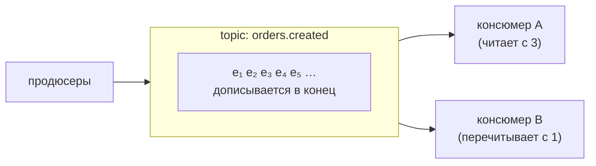

# Урок 2. Топики, партиции, офсеты

Kafka часто называют «большим логом» — и это самое точное описание. Разберём физическое устройство: во что пишутся события, как брокер хранит годы истории и почему порядок сообщений — не то, чем кажется.

## Topic: лог с именем

**Topic** — не «очередь», а **журнал (лог)**: события дописываются в конец и хранятся, а не удаляются после прочтения. Прочитали — просто запомнили, докуда.



Отсюда суперсила Kafka: два консюмера читают **один и тот же** topic с разных позиций и в разном темпе — данные не исчезают после первого прочтения. **Retention** (сколько хранить) настраивается на topic: часы, дни, годы — или «пока не кончится место».

## Partition: параллельный лог

Topic разбит на **партиции** — независимые логи на разных брокерах:

```text
topic: orders.created
├── partition 0:  e₁  e₄  e₅  e₈   ← ключ K1
├── partition 1:  e₂  e₃  e₆       ← ключ K2
└── partition 2:  e₇  e₉           ← ключ K3
```

Партиции дают две вещи:

1. **Масштаб записи и чтения**: разные партиции живут на разных брокерах; разные консюмеры группы читают разные партиции параллельно
2. **Порядок внутри партиции**: события одного ключа — всегда в порядке записи

## Ключ и правило порядка

Сообщение может иметь **ключ**. Одинаковый ключ → всегда одна и та же партиция (хэш ключа). Отсюда главное правило порядка в Kafka:

> **Гарантия порядка — только внутри партиции.** Хотите «события заказа 42 идут по порядку» — публикуйте их с ключом `"42"`, и они лягут в одну партицию друг за другом.

Без ключа события_ROUND_ROBIN'ятся по партициям — глобального порядка нет вовсе. Это не баг: для независимых событий порядок и не нужен.

Практика именования: `topic` — множественное число фактов (`orders.created`), ключ — идентичность сущности (`orderId`). Один заказ = один ключ = строгий порядок его событий.

## Offset: закладка читателя

**Offset** — номер события в партиции (0, 1, 2…). Позиция консюмера — это offset, и он принадлежит **группе** (groupId), а не отдельному процессу:

```text
partition 0:  e₁  e₂  e₃  [e₄]  e₅  e₆
                             ↑
        группа mail-service зафиксировала offset = 4
        (e₄ обработана, но коммит ещё не прошёл?)
```

Кто что читает — хранит сам Kafka (offsets topic). Поэтому:

- инстанс упал → поднялся → продолжает с зафиксированного offset'а своей группы;
- новая группа с нуля → прочитает **всю историю** topic'а (или с `earliest/latest` — как настроите);
- группу удалили → её offsets потеряны → новая с тем же именем начнёт по правилам «старта».

Коммит offset'а — момент истины: **закомитили после обработки** — потеряете при сбое минимум; закомитили до — рискуете потерять само событие. Подробно — в уроке 4.

## Сколько партиций нужно

Партиции — единица параллелизма: в группе не больше активных консюмеров, чем партиций topic'а (лишние сидят без работы). Мало партиций — узкое место чтения; много — дольше старт, больше файлов и запросов у брокера. Стартуют обычно с запасом (например, 6–12 для горячего topic'а), потому что **увеличить можно, а уменьшить — нельзя** (только пересозданием topic'а).

> **🔧 QA:** «дубликаты» и «пропуски» в асинхронных фичах почти всегда про offset'ы: закомитили до обработки — пропуск при сбое; после — дубль при ретрае. Тест с убийством консюмера на середине батча — высшая лига вашего ремесла.

> **📐 Аналитикам:** «источник правды по событиям» = topic с retention. Спрашивая «а можно выгрузить всё за прошлый квартал ещё раз», вы просите перечитать лог с offset'а начала квартала — это штатная операция, а не «сложно, нельзя».

## Итог

- Topic — лог: события дописываются в конец и хранятся по retention; читатели не удаляют данные
- Партиции — параллелизм и единица порядка; гарантия порядка — внутри партиции
- Ключ сообщения маршрутизирует в партицию: `orderId` ключом = порядок событий заказа
- Offset — закладка группы; коммит после обработки — меньшая из бед (дубль), до — потеря
- Партиции наращивают, но не сокращают: закладывайте запас сразу

## Квиз

```quiz
- type: single
  question: "Чем topic Kafka принципиально отличается от очереди (queue)?"
  options:
    - "События не удаляются после чтения: несколько групп могут читать один topic каждая со своей позиции"
    - "В topic нельзя писать больше одного продюсера"
    - "Очередь хранит данные дольше"
    - "Ничем не отличается"
  correct: 0
  explanation: "Очередь: взял — исчезло. Лог: дописал в конец — храни retention, читатели ходят с закладками-offset'ами. Отсюда перечитывание истории и независимость потребителей."

- type: single
  question: "Продакт требует: «статусы заказа 42 должны обрабатываться строго по порядку». Что гарантирует это?"
  options:
    - "Публиковать события заказа с ключом \"42\": одинаковый ключ → одна партиция → порядок внутри неё"
    - "Включить сортировку в брокере"
    - "Сделать topic с одной партицией для всех заказов"
    - "Ничего: Kafka всегда сохраняет глобальный порядок"
  correct: 0
  explanation: "Порядок — только внутри партиции, партиция выбирается хэшем ключа. Ключ = orderId даёт порядок событий каждого заказа и параллельность между заказами. Одна партиция для всех тоже дала бы порядок, но убила бы масштабирование."

- type: multi
  question: "Что верно про партиции? (несколько ответов)"
  options:
    - "Активных консюмеров в группе не может быть больше, чем партиций у topic'а"
    - "Партиции одного topic'а могут жить на разных брокерах"
    - "Партиции можно уменьшить командой на лету"
    - "Партиций можно добавить позже"
  correct: [0, 1, 3]
  explanation: "Уменьшение — только пересозданием topic'а. Поэтому параллелизм закладывают с запасом."

- type: blank
  question: "Как называется номер позиции события внутри партиции, который группа фиксирует как закладку чтения? (одно слово)"
  answers:
    - "offset"
    - "офсет"
  explanation: "Offset. Хранится у Kafka на группу+партицию; правила коммита определяют повторы/потери при сбоях."

- type: match
  question: "Сопоставьте понятие и смысл."
  pairs:
    - left: "Retention"
      right: "Сколько времени topic хранит события"
    - left: "Ключ сообщения"
      right: "Определяет партицию и группирует порядок"
    - left: "Consumer group"
      right: "Владеет offset'ами и делит партиции между инстансами"
    - left: "Брокер"
      right: "Сервер Kafka, хранит партиции"

- type: single
  question: "Группа analytics перечитывает topic с самого начала. Где лежит информация, с какого offset'а ей продолжать после рестарта?"
  options:
    - "В самой Kafka: offsets фиксируются на группу и партицию"
    - "В базе данных каждого консюмера — вручную"
    - "Нигде: каждый старт читает всё заново"
    - "В заголовке сообщения"
  correct: 0
  explanation: "Kafka хранит коммиты offset'ов по группам. Это и делает потребителей stateless-ми: упал-поднялся — продолжил с закладки."

- type: single
  question: "Команда создала topic с 3 партициями, а консюмеров в группе — 6. Что будет?"
  options:
    - "Активны только 3 консюмера — по числу партиций; остальные — горячий резерв"
    - "Все 6 будут читать каждую партицию"
    - "Kafka автоматически разрежет партиции"
    - "Ничего плохого: 6 > 3 — так и надо"
  correct: 0
  explanation: "Партиция — атом параллелизма: её нельзя делить внутри группы. Лишние инстансы ждут (резерв при падении). Хотите 6 рабочих — закладывайте ≥6 партиций."
```
