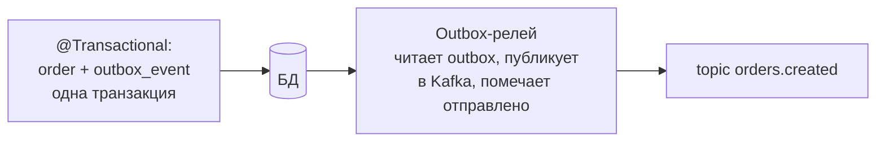

# Урок 5. Надёжность: паттерны доставки

Финальный урок собирает модуль в целостную картину: что значит «надёжная асинхронность», какие паттерны закрывают дыры доставки и где проходит граница цены надёжности.

## Семантики доставки: три слова, которые надо различать

| Семантика | Гарантия | Чем достигается |
|---|---|---|
| **At-most-once** | Не больше одного раза: могут быть потери | Коммит до обработки, acks низкие |
| **At-least-once** | Хотя бы один раз: возможны дубли | Коммит после обработки, acks=all |
| **Effectively-once** | Итоговый эффект ровно один | At-least-once + **идемпотентный** обработчик |

Kafka не даёт exactly-once «бесплатно» между произвольными системами. Реальность инженерии: **at-least-once + идемпотентность = effectively-once**. Поэтому центральный паттерн модуля — не настройка брокера, а дисциплина обработчика.

## Идемпотентный консюмер: как именно

Событие пришло повторно — эффект обязан быть тем же. Приёмы по нарастанию сложности:

**1. Естественная идемпотентность.** `SET status = 'CONFIRMED' WHERE id = 42` — повтор меняет ничего. Если операция так выглядит — вы уже защищены.

**2. Проверка по id события.** У события есть уникальный `eventId` (UUID). Обработчик в той же транзакции: записал `processed_events(eventId)` + выполнил эффект. Повтор видит «уже обработано» — выход.

**3. Версии/дедупликация по бизнес-ключу.** `user.version = 5` пришёл после `version = 7`? Устаревшее — игнор.

Бонус прагматика: «письмо о заказе» — идемпотентно само по себе (два письма — терпимо, но лучше не надо); «начисление бонуса» — требует строгой схемы 2.

## Transactional Outbox: атомарность БД + Kafka

Проблема dual-write из урока 3 — «сохранил в БД, не донёс до Kafka» — решается **таблицей-исходящим ящиком**:



```java
@Transactional
public void create(CreateOrderRequest r) {
    Order order = orderRepository.save(newOrder(r));
    outboxRepository.save(new OutboxEvent(
            "orders.created",
            String.valueOf(order.getId()),          // ключ
            toJson(new OrderCreatedEvent(order.getId()))));
}
```

Релей (отдельный поток/библиотека/Debezium) поллит таблицу, публикует и помечает. Свойства: заказ без события — невозможен (одна транзакция); событие без заказа — невозможно; дубль публикации — возможен, глушится идемпотентным консюмером. Outbox — обязательный паттерн там, где событие обязано случиться.

## Порядок vs параллелизм: саги и версии

Партиция даёт порядок событий одной сущности. Но потребители могли обработать с разной скоростью (ретраи, DLT) — эффект «e₃ применился раньше e₂». Защита:

- **Версии событий**: событие несёт `version`/`occurredAt`; обработчик применяет только более новое
- **Коммуникативные ассоциации**: обработка «заказ отменён» должна учитывать, что «заказ создан» мог ещё не дойти → обработчик ждёт/подтягивает состояние

Развязка длинных процессов — **сага**: цепочка локальных транзакций + компенсации («заказ создан → платёж прошёл → …; платёж не прошёл → заказ отменить»). Это ортогонально Kafka (саги бывают и на HTTP), но с событиями сага становится естественной формой.

## Сколько надёжности нужно?

Надёжность — не бесплатна: outbox — таблица и релей; strict-идемпотентность — хранение обработанных id; effectively-once — тесты тройных сценариев. Зрелая команда соизмеряет:

| Событие | Стоимость потери | Решение |
|---|---|---|
| Клики, метрики | Мала | at-most/at-least, без церемоний |
| «Заказ создан», «платёж прошёл» | Велика | acks=all + outbox + идемпотентный консюмер |
| Деньги, бухгалтерия | Критична | + строгая идемпотентность, сверки, possibly саги |

> **📐 Аналитикам:** таблица выше — почти готовый вопрос к требованиям: «что будет, если это событие потеряется/задвоится?» Ответ определяет бюджет надёжности фичи. Это самое дешёвое архитектурное решение, которое вы можете принять.

> **🔧 QA:** матрица тестов зрелого асинхронного контура: дубль, потеря (kill -9 консюмера), яд в DLT, порядок событий одной сущности, ребаланс. Пять сценариев, полчаса тестов, и асинхронность перестаёт быть «магией, которая иногда ломается».

## Итог

- Effectively-once = at-least-once + идемпотентный обработчик; «бесплатного» exactly-once нет
- Идемпотентность: естественная (SET) → eventId-таблица → версии
- Outbox делает «БД-изменение + событие» атомарными; релей и идемпотентный консюмер закрывают остальное
- Порядок при ретраях защищают версии событий; длинные процессы развязываются сагами
- Уровень надёжности выбирают по цене потери события — это продуктовое решение

Модуль пройден. Дальше — экзамен, кейс и лаба: настоящий продюсер и консюмер на встроенном Kafka-брокере.

## Квиз

```quiz
- type: single
  question: "«Effectively-once» в асинхронных системах достигается как…"
  options:
    - "At-least-once доставка + идемпотентный обработчик: дубли приходят, эффект один"
    - "Включением галочки exactly-once в брокере"
    - "Запретом ретраев"
    - "Одной партицией на всё"
  correct: 0
  explanation: "Доставка может дублировать — эффект обязана убирать сторона обработки. Пара at-least-once + идемпотентность и есть инженерный exactly-once."

- type: multi
  question: "Что даёт transactional outbox? (несколько ответов)"
  options:
    - "Заказ без события невозможен: одна транзакция БД"
    - "Событие без заказа невозможно"
    - "Полностью исключает дубли публикации"
    - "Релей публикует из таблицы и помечает отправленное"
  correct: [0, 1, 3]
  explanation: "Дубль публикации релеем возможен (крэш после send, до пометки) — и это нормально: его съест идемпотентный консюмер. Outbox решает атомарность, а не дубли."

- type: single
  codeLang: sql
  code: |
    UPDATE orders SET status = 'CANCELLED' WHERE id = 42 AND status <> 'CANCELLED';
  question: "Обработчик события отмены выполняет такой UPDATE. Какой вид идемпотентности работает?"
  options:
    - "Естественная: повторное выполнение ничего не меняет"
    - "Проверка по eventId"
    - "Версии событий"
    - "Никакая: нужен outbox"
  correct: 0
  explanation: "Повтор события даёт тот же результат (обновление 0 строк). Самый дешёвый вид идемпотентности — писать эффекты так, чтобы они были «перевыполняемы»."

- type: single
  question: "События заказа 42: created (v1) и cancelled (v2), консюмер обработал их в обратном порядке из-за ретрая. Что защищает?"
  options:
    - "Версии событий: обработчик игнорирует v1 после применённой v2"
    - "Ничего: порядок в партиции гарантирует порядок обработки"
    - "DLT: отменит устаревшее"
    - "acks=all"
  correct: 0
  explanation: "Порядок в партиции — порядок доставки, но не порядок эффектов (ретраи/DLT ломают его). Версия в событии — защита обработчика."

- type: blank
  question: "Как называется таблица, в которую событие атомарно пишется в транзакции с бизнес-данными, а отдельный релей публикует его в Kafka? (одним словом)"
  answers:
    - "outbox"
    - "аутбокс"
  explanation: "Outbox. Лечит dual-write: запись и «обязательство опубликовать» — одна транзакция."

- type: match
  question: "Сопоставьте событие и разумный уровень надёжности."
  pairs:
    - left: "Просмотр карточки товара"
      right: "At-most-once: потеря терпима"
    - left: "Заказ создан"
      right: "acks=all + outbox + идемпотентность"
    - left: "Платёж проведён"
      right: "Строгая идемпотентность, сверки"
    - left: "Клик по баннеру"
      right: "Дёшево и сердито: потери в пределах статистики"

- type: single
  question: "Итог модуля. Что делает асинхронный контур production-ready?"
  options:
    - "Acks=all, outbox для обязательных событий, идемпотентные обработчики, DLT с алертами, мониторинг лага"
    - "Одна большая партиция и молитва"
    - "Отключение ретраев везде"
    - "Синхронные HTTP-вызовы из каждого листенера"
  correct: 0
  explanation: "Четыре кита надёжности: доставка подтверждена, публикация атомарна, обработка идемпотентна, сбои видны (DLT + лаг). Синхронные вызовы из листенера возвращают связанность, от которой уходили."
```
