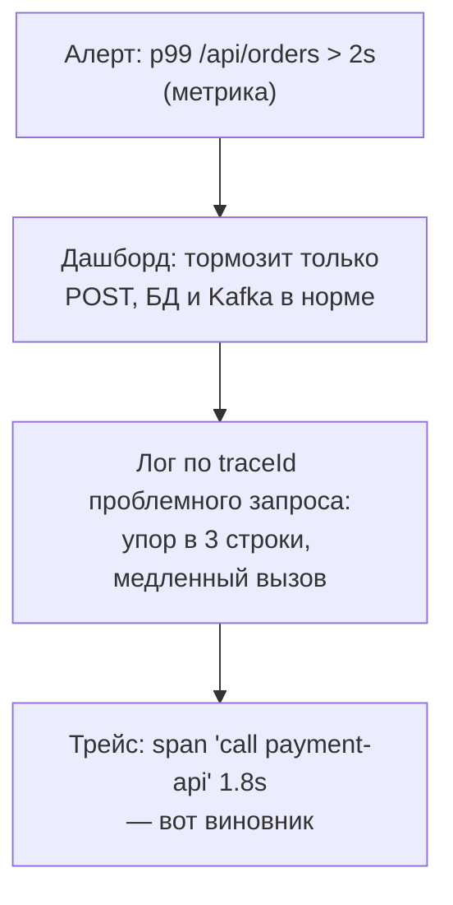

# Урок 1. Три столпа наблюдаемости

В пилоте вы трогали Actuator: `/actuator/health` и метрики «из коробки». Этот модуль — про то, как сделать сервис **наблюдаемым по-настоящему**: чтобы по дашборду было видно здоровье бизнеса, а по одному логу — вся история запроса. Начнём с карты местности.

## Мониторинг vs наблюдаемость

**Мониторинг** — заранее известный набор проверок: «диск заполнен?», «сервис отвечает 200?». Отвечает на *известные* вопросы.

**Наблюдаемость** — свойство системы: по её внешним сигналам можно понять *неизвестное* — «почему у Анны из Твери корзина не оформляется прямо сейчас?». Мониторинг ловит известные отказы, наблюдаемость позволяет расследовать новые.

Три столпа наблюдаемости:

| Столп | Формат | Вопрос | Инструменты |
|---|---|---|---|
| **Метрики** | числа во времени | «Сколько? Как быстро? Как часто падает?» | Micrometer → Prometheus, Grafana |
| **Логи** | текстовые события | «Что именно случилось?» | structured logging, Loki/ELK |
| **Трейсы** | путь запроса через сервисы | «Где застряло?» | traceId, OpenTelemetry |

Вместе они отвечают на главный вопрос: «система здорова, и если нет — где именно болит».

## Как они работают в связке

Типичное расследование инцидента «оформление заказа тормозит»:



Метрика говорит **что** и **когда**, лог — **что конкретно**, трейс — **где в цепочке**. Один столп без остальных оставляет слепые зоны.

## Метрики: язык чисел

Метрика — число с именем, временем и **тегами**:

```text
http_server_requests_seconds_count{uri="/api/orders", method="POST", status="201"}  4182
```

- имя — что меряем
- теги — по каким осям резать (URI, метод, статус, сервис)
- значение и время — ряд, из которого растут графики

Силу метрик даёт агрегируемость: «error rate по всем инстансам за 5 минут» — это один запрос к Prometheus, без чтения логов.

## Логи: язык событий

Лог — запись о событии с уровнем (ERROR/WARN/INFO/DEBUG) и контекстом (кто, что, traceId). Правила выживания:

- логи читают машины и люди: **структура** (JSON) важнее прозы
- ERROR — «нужен человек», WARN — «странно, но живём», INFO — факты, DEBUG — детали (выключены в проде)
- в ERROR-логе должна быть причина, а не только «что-то упало»

## Трейсы: язык путей

Запрос через микросервисы порождает **trace**: дерево **span'ов** — отрезков работы (контроллер → сервис → SQL → Kafka-send). Один **traceId** связывает всё. Без него «почему медленно» в распределённой системе — гадание: каждый сервис видит только свой кусок.

Трейсинг в Java — OpenTelemetry: библиотека автоинструментирует HTTP/JDBC/Kafka, вам остаётся propagated контекст.

> **🔧 QA:** наблюдаемость — тестируемое требование: «по каждой бизнес-ошибке есть WARN/ERROR с кодом», «метрика orders.created растёт после оформления», «в ответе API есть traceId для поддержки». Проверяется за минуты, экономит часы разборов.

> **📐 Аналитикам:** дашборд команды — это ваш интерфейс с системой в рантайме. Требования типа «конверсия заказов видна с задержкой не больше минуты» — это требования к метрикам и событиям, а не к ночной выгрузке.

## Итог

- Мониторинг отвечает на известное, наблюдаемость — на неизвестное
- Три столпа: метрики (сколько), логи (что), трейсы (где) — работают в связке
- Метрика = имя + теги + ряд значений; агрегируется и рисуется
- Логи: структурированные, уровни по смыслу, ERROR = нужен человек
- Трейс связывает путь запроса через сервисы одним traceId (OpenTelemetry)

В следующем уроке — метрики вглубь: Counter, Gauge, Timer и как одна строка Micrometer превращается в график на дашборде.

## Квиз

```quiz
- type: single
  question: "Поддержка спрашивает: «почему у пользователя не оформляется заказ?» Какой столп назовёт конкретное место сбоя в цепочке сервисов?"
  options:
    - "Трейс: span'ы покажут, где запрос застрял (контроллер, SQL, внешний вызов)"
    - "Метрика CPU utilization"
    - "Health-check /actuator/health"
    - "Лог доступа nginx за прошлый месяц"
  correct: 0
  explanation: "Трейс — про путь запроса через компоненты. Метрики скажут «есть проблема», логи — «что случилось», но связать куски по времени и месту — работа traceId."

- type: multi
  question: "Что верно про метрики? (несколько ответов)"
  options:
    - "Это числа с именами и тегами, собранные во времени"
    - "Они агрегируются: error rate за 5 минут по всем инстансам — один запрос"
    - "Они отвечают «что именно случилось с конкретным заказом» лучше логов"
    - "Теги позволяют резать данные по осям: URI, метод, статус"
  correct: [0, 1, 3]
  explanation: "«Что именно с конкретным заказом» — территория логов и трейсов: метрики про популяции, а не про индивидуумов."

- type: match
  question: "Сопоставьте столп и типичный вопрос."
  pairs:
    - left: "Метрики"
      right: "Какой p99 задержки на POST /api/orders?"
    - left: "Логи"
      right: "Какая ошибка выпала у заказа 42?"
    - left: "Трейсы"
      right: "На каком сервисе запрос потратил 1.8 секунды?"
    - left: "Health"
      right: "Жив ли инстанс вообще?"

- type: single
  question: "Что значит ERROR в зрелой системе логирования?"
  options:
    - "«Нужен человек»: потеря функциональности или риска; ERROR-шум — антипаттерн"
    - "Любое исключение, даже обработанное и ожидаемое"
    - "Просто самый громкий уровень — пишем всё подряд"
    - "То же, что и WARN"
  correct: 0
  explanation: "Если ERROR сыпется на каждый ожидаемый 404 — на алерты никто не смотрит. Уровень — это серьёзность последствий, а не громкость испуга."

- type: blank
  question: "Как называется идентификатор, связывающий все логи и span'ы одного запроса across сервисы? (формат: …Id)"
  answers:
    - "traceId"
    - "trace id"
    - "трейс-id"
  explanation: "TraceId. Пробрасывается через HTTP-заголовки и Kafka-заголовки; найден в одном логе — найдёте всю историю запроса."

- type: single
  question: "Отладочная история: алерт сработал → дашборд сузил → лог назвал строку → трейс показал span. Что это демонстрирует?"
  options:
    - "Три столпа работают в связке: каждый отвечает на свой вопрос и передаёт эстафету"
    - "Что трейсинг лишний"
    - "Что метрики можно убрать"
    - "Что достаточно логов"
  correct: 0
  explanation: "Классический цикл расследования: что → где → что именно → где точно. Ровно этому посвящён модуль."

- type: single
  question: "Чем наблюдаемость отличается от мониторинга?"
  options:
    - "Наблюдаемость позволяет расследовать неизвестные заранее проблемы по внешним сигналам; мониторинг — проверки известного списка"
    - "Это синонимы"
    - "Мониторинг новее"
    - "Наблюдаемость — только логи"
  correct: 0
  explanation: "Мониторинг: «диск заполнен?» Наблюдаемость: «почему у Анны не оформляется корзина?» — вопрос, которого не было в чек-листе."
```
