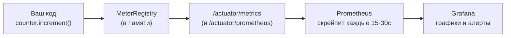

# Урок 2. Метрики: Micrometer вглубь

Micrometer — «SLF4J для метрик»: один API, много бэкендов (Prometheus, Datadog…). Вы пишете метрику один раз — график появляется там, куда смотрит команда. Разберём типы счётчиков и путь от кода до дашборда.

## Три главных типа

**Counter — «сколько раз».** Только растёт: заказы, ошибки, запросы.

```java
private final Counter ordersCreated;

public OrderService(MeterRegistry registry) {
    this.ordersCreated = Counter.builder("orders.created.total")
            .description("Создано заказов")
            .tag("service", "orders")
            .register(registry);
}

public Order create(...) {
    ...
    ordersCreated.increment();          // +1
}
```

**Gauge — «сколько сейчас».** Текущее значение, может падать: размер очереди, число подключений.

```java
Gauge.builder("orders.pending", store, s -> s.pendingCount())
        .register(registry);
```

Gauge снимает значение в момент опроса — меряет то, что уже где-то лежит; он не хранит историю сам.

**Timer — «сколько длилось».** Распределение длительностей: p50/p95/p99.

```java
private final Timer createTimer;

public OrderService(MeterRegistry registry) {
    this.createTimer = Timer.builder("orders.create.time")
            .description("Время создания заказа")
            .register(registry);
}

public Order create(...) {
    long start = System.nanoTime();
    ...
    createTimer.record(System.nanoTime() - start, TimeUnit.NANOSECONDS);
}
```

Или декларативно на весь метод: `@Timed("orders.create.time")` (+ включить `@EnableTiming`).

Именование: `домен.действие.единицы` — `orders.created.total`, `payments.charge.seconds`. Точки — Micrometer сам нормализует под бэкенд.

## Теги: оси, а не ряды

Теги — способ резать одну метрику по осям без её размножения в коде:

```text
http_server_requests_seconds_count{method="POST", uri="/api/orders", status="2xx"}
http_server_requests_seconds_count{method="POST", uri="/api/orders", status="5xx"}
```

Одна метрика — сколько угодно срезов в одном графике: «разложи 5xx по URI». Меняете набор тегов — меняется временной ряд (старый ряд обрывается): продумывайте их заранее.

**Кардинальность — главный враг.** Тег с уникальными значениями (`userId`, `email`, `orderId`) создаёт новый ряд на каждое значение — Prometheus деградирует, а не «немного замедляется». Правило: теги — конечные множества (метод, статус, тип), пользовательские id — в логи и трейсы, не в метрики.

## Путь на дашборд



1. Метрика живёт в реестре приложения (Spring создаёт `MeterRegistry` под classpath)
2. `/actuator/metrics/orders.created.total` — посмотреть руками прямо сейчас (это и есть лаба 7)
3. Prometheus **pull'ит** приложение по расписанию — хранит историю
4. Grafana рисует и алертит

Плюс автоматические метрики Spring Boot: HTTP (`http.server.requests` с uri/method/status), JVM (память, GC), пулы, Kafka-клиент, HikariPool — они уже у вас есть, включите `management.metrics` и пользуйтесь.

## @Scheduled-метрики и «красота» богатства

Уровнем выше — агрегаты, которые команда считает сама: раз в минуту писать Gauge от SQL-запроса (`db.orders.unshipped`), счётчик DLT-сообщений, глубину outbox. Правило безопасности: тяжёлые вычисления — не в запросе пользователя, а по расписанию.

## Итог

- Типы: Counter (сколько раз), Gauge (сколько сейчас), Timer (как долго, перцентили)
- Регистрация в конструкторе через `MeterRegistry`; `@Timed` — декларативно
- Теги — оси срезов; кардинальность убивает Prometheus: id-шники — в логи
- Путь: код → реестр → /actuator/metrics → Prometheus (pull) → Grafana
- Богатство Spring Boot: HTTP/JVM/пулы/Kafka-метрики уже есть из коробки

Следующий урок — что именно мерить: золотые сигналы, бизнес-метрики и типовой набор сервиса.

## Квиз

```quiz
- type: single
  question: "Нужно мерить «сколько заказов оформлено с момента запуска». Какой тип метрики?"
  options:
    - "Counter — только растущее число событий"
    - "Gauge — текущее значение"
    - "Timer — длительности"
    - "Histogram текстовых ошибок"
  correct: 0
  explanation: "«Сколько раз случилось» = Counter. Gauge — «сколько прямо сейчас» (например, необработанных), Timer — «как долго»."

- type: single
  question: "Почему тег userId в метрике заказов — антипаттерн?"
  options:
    - "Каждый пользователь создаст новый временной ряд — кардинальность взорвёт хранилище метрик"
    - "Prometheus не поддерживает строковые теги"
    - "Grafana не умеет фильтровать по тегам"
    - "Micrometer запрещает больше одного тега"
  correct: 0
  explanation: "Теги — для конечных осей (метод, статус). Уникальные id — в логи/трейсы: там поиск по конкретному заказу уместен."

- type: multi
  question: "Что даёт /actuator/metrics? (несколько ответов)"
  options:
    - "Посмотреть текущее значение любой метрики прямо в браузере/курлом"
    - "Увидеть список всех метрик приложения"
    - "Хранит историю метрик вечно"
    - "Точка, которую скрейпит Prometheus"
  correct: [0, 1, 3]
  explanation: "Историю хранит Prometheus; endpoint — витрина «прямо сейчас» и источник для скрейпера. Это ваш главный отладочный ход в лабе 7."

- type: match
  question: "Сопоставьте тип метрики и вопрос."
  pairs:
    - left: "Counter"
      right: "Сколько заказов создано?"
    - left: "Gauge"
      right: "Сколько заказов ждёт отгрузки сейчас?"
    - left: "Timer"
      right: "Какой p99 времени создания заказа?"
    - left: "http.server.requests"
      right: "Готовая метрика Spring Boot по HTTP-запросам"

- type: single
  codeLang: java
  code: |
    Timer.builder("orders.create.time")
         .description("Время создания заказа")
         .register(registry);
  question: "Что вы получите из этой метрики в Grafana?"
  options:
    - "Распределение длительностей: можно рисовать p50/p95/p99 времени создания"
    - "Только среднее время"
    - "Число созданных заказов"
    - "Код ошибки для каждого заказа"
  correct: 0
  explanation: "Timer собирает гистограмму длительностей — отсюда перцентили. Среднее — лишь одна (и часто обманчивая) точка этого распределения."

- type: blank
  question: "Как называется реестр метрик Micrometer, который Spring автосоздаёт и в который вы регистрируете счётчики? (класс: Meter…)"
  answers:
    - "MeterRegistry"
    - "meterregistry"
  explanation: "MeterRegistry. Как SLF4J-логгер для метрик: пишете в него, бэкенд (Prometheus и др.) подключается конфигурацией."

- type: single
  question: "Как метрики попадают из приложения в Prometheus?"
  options:
    - "Prometheus сам опрашивает (pull) endpoint приложения по расписанию"
    - "Приложение пушит каждую метрику в Prometheus на каждый increment()"
    - "Grafana читает память приложения напрямую"
    - "Через базу данных"
  correct: 0
  explanation: "Pull-модель: Prometheus скрейпит /actuator/prometheus каждые 15–30 секунд. Приложение ничего не знает про хранилище — развязка как у брокера."
```
