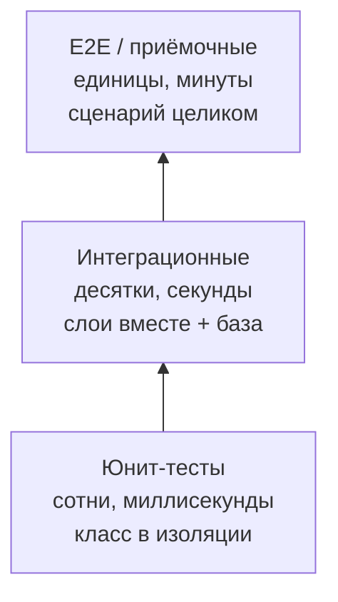

# Урок 1. Зачем тесты и их уровни

Вы уже весь курс живёте с тестами: каждая лаба принималась тестами-приёмниками. Этот модуль — про другую сторону: **тесты пишете вы**. Для QA это перевод вашего опыта на Java-рельсы; для фронтендеров и аналитиков — способ думать о правильности кода до продакшена.

## Что вообще защищает тест

Тест — это **исполняемая спецификация**: «при таких входах поведение должно быть таким». Пока правило живёт в голове или в ТЗ — оно мнение; записанное в тест — оно автоматически проверяется каждым билдом.

Ценности по убыванию:

1. **Регрессия**: изменение сломало старое — тест покраснел через минуту, а не через неделю на проде
2. **Дизайн кода**: код, который неудобно тестировать, обычно перегружен связями — тесты проявляют это болью
3. **Документация**: тест `cancelOrder_whenAlreadyShipped_throws` читается как ТЗ без открытия ТЗ
4. **Смелость рефакторить**: зелёная полоса после переезда на новую библиотеку стоит дороже её написания

Чего тесты НЕ делают: не доказывают отсутствие багов (только покрытие проверенных случаев), не заменяют ревью и прод-наблюдаемость.

## Пирамида: три уровня



| Уровень | Что проверяет | Скорость | Пример из курса |
|---|---|---|---|
| **Юнит** | Один класс: сервис с моком репозитория | мс | «скидка считается по правилу» |
| **Интеграционный** | Слои вместе: контроллер → сервис → БД (H2/Testcontainers) | секунды | Лаба 2: `TaskApiTest` через MockMvc |
| **E2E / приёмочный** | Сценарий пользователя через настоящий интерфейс | минуты | «оформил заказ — пришло письмо» |

Смысл пирамиды — **экономика**: юниты дешёвые и точные (упал юнит — сразу знаешь где), верх дорогой и «грязный» (упал E2E — ищи где угодно). Поэтому: много юнитов, меньше интеграционных, мало E2E. Перевёрнутая пирамида («всё через UI») = медленный и хрупкий набор.

В курсе и реальных проектах правило прилегания простое: **логика — юниты, границы (HTTP, БД, Kafka) — интеграционные**, пользовательские сценарии — E2E.

## Быстрый взгляд: как выглядит юнит-тест

```java
@Test
void cancelOrder_whenNotShipped_setsStatusCancelled() {
    // Arrange: подготовили данные и заглушки
    Order order = new Order(42L, OrderStatus.NEW);
    given(orderRepository.findById(42L)).willReturn(Optional.of(order));

    // Act: выполнили действие
    orderService.cancel(42L);

    // Assert: проверили результат
    assertThat(order.getStatus()).isEqualTo(OrderStatus.CANCELLED);
}
```

Три фазы — **Arrange–Act–Assert (AAA)**: подготовка, действие, проверка. Имя теста — история: `метод_когда_условие_результат`. Подробности — следующий урок.

> **🔧 QA:** модуль переводит ваш навык на код: тест-дизайн (границы, негативы, комбинации) тот же, носитель другой. Ваши кейсы из TestRail становятся @Test-методами; параметризация — это data-driven, который вы знаете.

> **💡 Фронтендерам:** вы писали Jest/Vitest — это оно же: AAA, моки, describe. Отличие бэкенда — интеграционные с настоящей базой: фронт мокает fetch, бэк «мокать SQL» не спешит — честнее проверить контейнер с PostgreSQL.

> **📐 Аналитикам:** тесты — исполняемая версия ваших требований. Читая список тест-методов сервиса, вы видите, какие правила действительно закодированы, а какие остались только в ТЗ. Разрыв между ними — карта рисков.

## Порядок вместо хаоса: что тестировать в первую очередь

- **Бизнес-правила** (сервисный слой): скидки, статусы, лимиты — здесь ошибки дороже всего
- **Границы**: валидация входов, ошибки (400/404/409), статус-коды
- **Данные**: миграции, запросы с фильтрами и пагинацией
- Прочее (геттеры, конфигурация) — не тестируют: их проверяет компилятор и контекст старта

## Итог

- Тест = исполняемая спецификация; главная ценность — быстрая регрессия и смелость менять
- Пирамида: много юнитов (мс), меньше интеграционных (с), единицы E2E (мин)
- Логика — юнитами; границы (HTTP/БД/Kafka) — интеграционными; сценарии — E2E
- Тесты не заменяют ревью и мониторинг — они третья линия обороны, а не единственная
- В первую очередь тестируют бизнес-правила и границы, а не геттеры

В следующем уроке — JUnit и Mockito в руках: структура теста, ассерты, моки.

## Квиз

```quiz
- type: single
  question: "Что значит «тест — исполняемая спецификация»?"
  options:
    - "Правило записано кодом и автоматически проверяется каждым билдом, а не живёт только в ТЗ или голове"
    - "Тест заменяет техническое задание"
    - "Тесты пишет аналитик, а не разработчик"
    - "Спецификация компилируется вместе с кодом"
  correct: 0
  explanation: "Пока правило в голове — оно мнение. В тесте — автоматически проверяемый факт, который кричит при нарушении на каждом запуске CI."

- type: match
  question: "Сопоставьте уровень теста и проверяемое."
  pairs:
    - left: "Юнит"
      right: "Сервис с моком репозитория: правило скидки"
    - left: "Интеграционный"
      right: "Контроллер → сервис → H2: POST отдаёт 201 и строку в базе"
    - left: "E2E"
      right: "Оформил заказ в интерфейсе — пришло письмо"
    - left: "Контрактный (тизер урока 5)"
      right: "Живой API не разошёлся со OpenAPI-спекой"

- type: single
  question: "Почему пирамида — много юнитов и мало E2E?"
  options:
    - "Экономика: юниты быстрые и указывают на место ошибки точно, E2E медленные и падение ничего не говорит о месте"
    - "E2E запрещены стандартом"
    - "Юниты пишутся автоматически"
    - "E2E не находят баги"
  correct: 0
  explanation: "Красный юнит = «вот класс», красный E2E = «где-то в цепочке из десяти сервисов». Пирамида балансирует цену запуска и точность диагностики."

- type: multi
  question: "Что дают тесты? (несколько ответов)"
  options:
    - "Быструю регрессию: изменение сломало старое — красный билд"
    - "Смелость рефакторить под зелёный набор"
    - "Доказательство отсутствия багов"
    - "Исполняемую документацию поведения"
  correct: [0, 1, 3]
  explanation: "«Нет багов» тесты не доказывают: они проверяют только вошедшие в них случаи. Ревью и наблюдаемость никто не отменял."

- type: single
  question: "Сервис считает скидку по пяти правилам. Что тестировать в первую очередь?"
  options:
    - "Сервисный слой юнит-тестами: бизнес-правила — самое дорогое место для ошибки"
    - "Геттеры полей скидки"
    - "Только E2E через интерфейс"
    - "Файл конфигурации"
  correct: 0
  explanation: "Приоритет — там, где живёт бизнес-логика и деньги. Геттеры проверяет компилятор, конфигурацию — старт контекста."

- type: blank
  question: "Как называется трёхфазная структура теста «подготовка → действие → проверка»? (три слова через дефис)"
  answers:
    - "arrange-act-assert"
    - "arrange act assert"
    - "aaa"
  explanation: "Arrange–Act–Assert (AAA). Читается сверху вниз как сценарий; если фазы перемешаны — тест трудно понимать и чинить."

- type: single
  question: "Фронтендер пишет мок fetch, бэкендер «мокает SQL» и удивляется расхождению с продом. Какой уровень закрыл бы проблему честно?"
  options:
    - "Интеграционный с настоящей базой: H2 в лабах, Testcontainers (настоящий PostgreSQL) для серьёзных случаев"
    - "Больше юнитов с моками репозитория"
    - "Только E2E на проде"
    - "Ручная проверка перед релизом"
  correct: 0
  explanation: "SQL-диалект, транзакции и блокировки мок не воспроизведёт. Границу с базой проверяют настоящей базой — в памяти или в контейнере (урок 4)."
```
