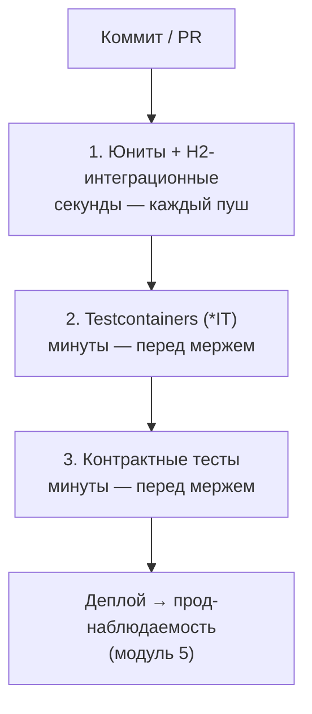

# Урок 5. Контрактные тесты и CI

Последний урок модуля отвечает на два вопроса: «как тесты удерживают договор с потребителями» и «как всё это собрать в конвейер, который работает на команду, а не наоборот».

## Контрактный тест: API не разошёлся со спекой

В модуле 2 договор описан в OpenAPI. Контрактный тест сверяет **живой API со спекой**: каждый путь, статус, схему ответа.

```text
1. Подняли приложение (те же @SpringBootTest)
2. Прогнали запросы по всем путям спеки
3. Сверили: статус из спеки = фактический, поля ответа = схеме
4. Расхождение → красный билд
```

Инструменты: Schemathesis (генерирует проверки прямо из спеки, находит и 500-е), springdoc + тесты OpenAPI-валидации. Что ловится: поле удалили из ответа, а в спеке осталось; новый эндпоинт не описали; статус поменялся с 200 на 204 молча.

Связь с командой (модуль 2): PR со спекой ревьится потребителями; контрактный тест в CI — это **ревью, которое не устаёт**. Именно так тесты-приёмники ваших лаб и «тесты по спеке» из уроков про API становятся одной системой.

## Пирамида в CI: лестница скорости



Правила конвейера:

- **Красный билд = приоритет №1**: всё останавливается до зелёного (сломанный конвейер metastазирует в «никто не смотрит на CI»)
- Лестница скорости: мгновенное — каждому пуши; тяжёлое — реже
- Тесты **должны быть детерминированными**: flaky-тест (падает через раз) чинят или удаляют немедленно — он разрушает доверие ко всему набору

## Flaky: главный враг доверия

Причины типовых «через раз»:

- **Время и порядок**: sleep вместо ожидания условия; тесты зависят друг от друга
- **Данные**: тест рассчитан на пустую базу, а что-то осталось
- **Параллельность**: тесты бегут одновременно и делят состояние
- **Внешний мир**: реальный вызов внешнего API в тесте

Лечение: Awaitility-стиль «ждать условие, а не секунды»; изоляция через `@Transactional`/чистку; внешние границы — мок или контейнер. Flaky принято помечать (assumeTrue/quarantine) и чинить в приоритете — не «перезапустить и забыть».

## TDD: тест до кода

**TDD (Test-Driven Development)**: красный тест → минимальный код до зелёного → рефакторинг. Самая чистая форма «тест как спецификация»: сначала формулируешь поведение, потом реализуешь. Полный TDD — привычка не всех команд, но его элементы вы уже видели: тесты-приёмники лаб пишутся ДО кода; исправить красноту — и есть цикл TDD в миниатюре.

## Coverage: термометр, а не цель

Покрытие (`mvn verify` + JaCoCo) показывает, какие строки выполнялись тестами. Здоровое использование: **найти дыры** — «класс X не покрыт вообще» — сигнал. Больное: гнаться за цифрой тестами без ассертов (строка «выполнилась» ≠ «проверилась»). Команды ставят нижнюю планку на改动 (например, новый код ≥ 60–80%) — но планка без культуры ассертов рождает мусорные тесты.

> **🔧 QA:** карта ваших возможностей в этом модуле: API-тесты → MockMvc-классы рядом с кодом; data-driven → @ParameterizedTest; пограничные кейсы → контрактные проверки; flaky-репорты — ваша зона в CI-дашборде наравне с разработчиками.

> **📐 Аналитикам:** список тест-методов сервиса — исполняемая версия требований. Ревью «что закодировано» = сравнение вашего ТЗ с тестами; разрывы — backlog рисков приоритетно.

## Итог — и модуль, и курс

- Контрактный тест = живой API ↔ OpenAPI-спека; расхождение — красный билд, а не тихий бой фронтенда
- CI — лестница скорости: юниты каждому пушу, контейнеры и контракты — перед мержем; красный билд — стоп-сигнал
- Flaky чинят немедленно: доверие к конвейеру дороже любого теста
- TDD: спецификация до кода; тесты-приёмники курса — его миниатюра
- Coverage — термометр для поиска дыр, а не KPI

Модуль «Тесты» закрыт: вы умеете читать и писать юниты, поднимать слои интеграционно, проверять границы честными контейнерами и держать контракт в CI. Экзамен — впереди.

## Квиз

```quiz
- type: single
  question: "Что именно проверяет контрактный тест?"
  options:
    - "Живой API соответствует OpenAPI-спеке: пути, статусы, схемы ответов"
    - "Что код скомпилировался"
    - "Что UI красивый"
    - "Скорость базы"
  correct: 0
  explanation: "Это ревью договора, работающее круглосуточно: добавили поле в код и забыли спеку — билд красный до того, как заметит фронтенд."

- type: multi
  question: "Признаки здорового CI-конвейера: (несколько ответов)"
  options:
    - "Быстрые проверки на каждый пуш, тяжёлые — перед мержем"
    - "Красный билд — приоритет №1 для команды"
    - "Flaky-тесты перезапускают до зелёного и забывают"
    - "Тесты детерминированы: одинаковый результат при каждом запуске"
  correct: [0, 1, 3]
  explanation: "«Перезапустить и забыть» — как раз разрушение доверия: flaky чинят или помещают в карантин с тикетом."

- type: single
  question: "Тест падает «через раз» в CI и всегда зелёный локально. Первая гипотеза?"
  options:
    - "Недетерминированность: параллельность, порядок, данные или реальное время — локально условия мягче"
    - "CI-сервер сломан"
    - "Тест правильный, прод неправильный"
    - "Нужно отключить тест"
  correct: 0
  explanation: "Классика flaky: гонки и утечки состояния. ЛечитсяAwaitility-ожиданиями, изоляцией данных, моками внешних вызовов."

- type: blank
  question: "Как называется практика «сначала красный тест, затем минимальный код до зелёного, затем рефакторинг»? (аббревиатура)"
  answers:
    - "TDD"
    - "tdd"
  explanation: "Test-Driven Development. Тесты-приёмники лаб курса — его миниатюра: контракт существует до реализации."

- type: match
  question: "Сопоставьте уровень проверки и фазу CI."
  pairs:
    - left: "Юниты + MockMvc + H2"
      right: "Каждый пуш, секунды"
    - left: "Testcontainers (*IT)"
      right: "Перед мержем, минуты"
    - left: "Контрактные тесты"
      right: "Перед мержем: API ↔ спека"
    - left: "Прод-метрики и алерты"
      right: "После деплоя (модуль 5)"

- type: single
  question: "Команда ввела планку coverage 90% и через квартал получила 91% и кучу падающих прод-багов. Что пошло не так?"
  options:
    - "Цифра стала целью: тесты ради покрытия (без ассертов, на моках всего) — строки «выполнялись», поведение не проверялось"
    - "90% слишком мало, нужно 95%"
    - "Coverage вообще не работает"
    - "Виноваты тестировщики"
  correct: 0
  explanation: "Гудхарт: метрика перестаёт быть полезной, став целью. Coverage — термометр для поиска дыр; качество определяется ассертами и уровнем тестов."

- type: single
  question: "Итог модуля. Фича «отмена заказа»: где какие проверки?"
  options:
    - "Правила отмены — юниты сервиса; POST /cancel → 409/204 — MockMvc; отменённый не отображается — контейнерный тест с настоящей БД; API ↔ спека — контрактный в CI"
    - "Всё проверить одним E2E-тестом"
    - "Только юниты: остальное дорого"
    - "Проверит прод-мониторинг после релиза"
  correct: 0
  explanation: "Пирамида в действии: каждому риску — свой уровень, от миллисекундных правил до контракта в конвейере. Именно это вы соберёте сами в лабах модуля."
```
